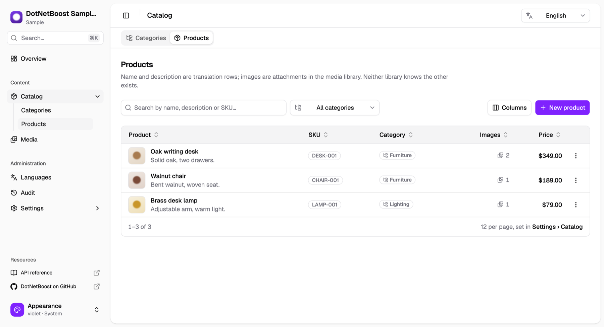
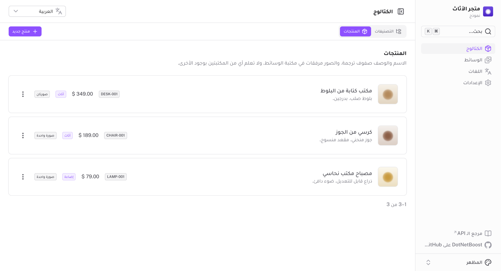

# DotNetBoost Sample

**Four DotNetBoost libraries in one application, with zero references between them.**

This sample installs [DotNetBoost.Settings](https://www.nuget.org/packages/DotNetBoost.Settings.Core),
[DotNetBoost.Media](https://www.nuget.org/packages/DotNetBoost.Media.Core),
[DotNetBoost.MultiLingual](https://www.nuget.org/packages/DotNetBoost.MultiLingual.Core) and
[DotNetBoost.Auditing](https://www.nuget.org/packages/DotNetBoost.Auditing.Core) from nuget.org and
composes them into a small product catalogue — a store with categories and products whose names are
translated, product images with per-language alt text, branding you can change at runtime, and a
trail of who changed what, when, and from what to what.

What it is built to demonstrate is as much what is *absent* as what is present:

- no `DotNetBoost.Core` or `DotNetBoost.Abstractions` shared-kernel package
- no `AddDotNetBoost(b => b.AddSettings().AddMedia())` unifying builder
- no integration package pairing any two libraries

Each library is installed on its own and configured on its own terms. Everything that joins them
is this application's code, in nine files — counted honestly below. `tests/` asserts that none of
them references another, so the claim cannot quietly stop being true.

**Auditing was added last, to a solution the other three were already in**, which is the one measure
of "no shared kernel" that cannot be faked by reading the libraries already installed: it cost one
`Apply*` line, one registration block, `UseAuditing(sp)` beside `UseMultiLingual(sp)` on the
context, and nothing at all in the two projects that do not store anything — no handler records
anything. It also cost something the other three never did: for one release the library's
zero-code change capture **could not be used here**, because another library in the same
`DbContext` has an entity an audit entry cannot address, and the catalogue recorded its own changes
by hand. DotNetBoost.Auditing `1.0.0-preview.2` closed that with one builder method and no reference
to the other library. [MultiLingual's row is not in the trail](#6-multilinguals-row-is-not-in-the-trail) is the finding
and the fix, and it is the most useful thing in this repository about what independence actually
costs.

The application around them is a monolith in four projects, with its own routes written as vertical
slices and dispatched as commands and queries — one file per feature, and no MediatR. [How the
application is built](#how-the-application-is-built) has that part; the five files come first,
because they are the point.

---

## The dashboard


A sidebar shell matching the four libraries' own dashboards — **Catalog**, **Media**,
**Languages**, **Audit**, **Settings**, with the reading-language selector in every page header.

That one selector moves **both** languages in the dashboard. The content language is a row in
DotNetBoost.MultiLingual that the API resolves from `Accept-Language`; the dashboard's own labels,
buttons, help text and toasts are static bundles under `clients/dashboard/i18n/locales` —
English, Arabic and French, the three the sample seeds. Nothing makes them the same thing, so
`app/plugins/ui-language.ts` is the one file that decides they move together. A second switcher
for the chrome would be a second answer to the same question, and two answers can disagree.

Add a language on the Languages page and it has content long before it has a bundle: the labels
fall back to English, and the shell still flips if the language reads right-to-left, because
direction travels with the language row rather than with the translation file.

The choice is **remembered**, so the dashboard reopens in the language you left it in. Its
direction is remembered beside it — a cache of the API's last answer, not a list of RTL codes in
the client — so a remembered Arabic opens right-to-left on the first paint instead of flipping a
round trip later. A language that was deleted or deactivated in the meantime falls back to the
default rather than leaving the selector stuck on a code that no longer exists.

The same page, read in English and in Arabic. Nothing is duplicated between them: the product
names and descriptions are translation rows the API resolved from `Accept-Language`, the labels
around them are the dashboard's own bundles, and the shell is right-to-left because direction
travels with the language row.

| English | العربية |
|---|---|
|  |  |

Counts are pluralised by CLDR rules rather than by an English `-s`, which is why two products
read **منتجان** in Arabic — the dual — and zero reads *0 produit* in French. Dates, relative times
and file sizes come from `Intl` in the UI locale, so a size is `1.4MB`, `1,4Mo` or `1.4 م.ب`
without a unit name being written down anywhere.

The sidebar header is the whole sample in miniature: the store's **name** is a
DotNetBoost.Settings value, its **logo** is a DotNetBoost.Media attachment, the **size** that logo
is drawn at is another setting, and nothing but `BrandingProjector` knows all three exist. Change
any of them on the Settings page and the header follows on the next read — no restart, no redeploy.


One page, three libraries, and no file of its own — `pages/settings/[route].vue` draws every
group. The form is Settings'; `Store name in other languages` appears because the group's schema
reports a `[MultiLingual]` property; the `Logo` box appears because the group's response publishes
the owner its media is filed under, and `GET /api/media/roles/Branding` says that owner has one
single-valued role.

**Settings** is DotNetBoost.Settings' own dashboard design: a tab per `[SettingGroup]`, and a form
*generated from what the group says about itself* rather than written out — a `bool` becomes a
switch, an `int` a number spinner, a `string` an input. Add a property to the C# class and the field
appears; remove one and it goes, which is exactly what happened when `LogoFileId` left
`BrandingSettings`.

The **bounds** come from the class too. `GET /api/settings/{group}/schema` publishes each property's
type, its default, whether it is `[Sensitive]`, and the constraints its validators enforce — so
`headerLogoSize`'s 16–64 range is `BrandingSettingsValidator`'s rule, read by the control that draws
it. It used to be a literal in the client that matched nothing in C#, and that the API would have
accepted any value outside. Try saving 500: refused with `400`, by the same rule the form drew.

The **tabs** come from the class too. `GET /api/settings` names the registered groups, so adding a
`[SettingGroup]` class in C# puts a working tab on this page with no change in the client at all:
it gets a default icon and a form generated from its own schema, through one dynamic page. That is
why there is no `pages/settings/catalog.vue` — there is a `[route].vue`. Branding keeps a page of
its own only because it has more than a form: per-language text, and a logo.

Even `translated` comes from the class. That flag mirrors `[MultiLingual]` — DotNetBoost.MultiLingual's
attribute, which the settings engine has never heard of and cannot publish on its own. So this
application publishes it, in `Settings/MultiLingualSchemaContributor.cs`: about ten lines
implementing `ISettingSchemaContributor`, asking `MultiLingualMetadata` which properties are
translatable rather than reimplementing the rule. The schema endpoint **merges** contributors, so
`storeName` comes back carrying `required` and `maxLength` from its validator *and* `translated`
from here — until preview.2 it took only the first, and registering this would have silently
deleted the bounds.

Which leaves exactly one thing in `clients/dashboard/app/utils/settings.ts`: a map from route to
icon. Nothing about any property, in any group.

Saves are conditional: the `GET` returns an `ETag`, the `POST` sends it back as `If-Match`, and a
save that would overwrite someone else's is refused with `412`. The form then offers to re-apply
only the fields *you* edited on top of the latest values, so neither writer clobbers the other.
Verified by changing a group out-of-band mid-edit.

The second tab, **Catalog**, is there to show a group that is read somewhere other than the page
that writes it — three values, each landing in a different place:

| | |
|---|---|
| `PageSize` | How many products `GET /api/products` answers with. The catalogue list asks for no page size, so this is the one that decides; the table's footer says so and links here. |
| `CurrencySymbol` | The glyph beside a price. Only the glyph — `Intl` places it, so the same `€` reads `€349.00` in English and `349.00 €` in Arabic. |

Change `PageSize` from 12 to 2, reload the Catalog page, and it pages by two — no restart, no
redeploy, which is the entire claim of a settings library and is worth seeing actually happen.

**Languages** is DotNetBoost.MultiLingual's own page: a table with the code, the name written in
its own script and direction, the direction badge, the default marker, an active switch, and a
per-row menu for edit, make-default, *delete its translations* and delete. Refusals are shown in
the API's words — deactivating the default answers "The default language cannot be deactivated.
Promote another language to default first", and the switch snaps back.

Leaving Direction as "from the code" lets the API derive it from the runtime's culture data:
adding `he` comes back right-to-left without being told.


**Media** is DotNetBoost.Media's own browser, lifted wholesale — search, category and tag filters,
content-type filter, sorting, paging, upload, file details, attachments and delete, all of it in
the query the API is asked rather than applied to the rows already on screen. The one addition is
**alt text**, which appears in a file's details below "Used by": it is not media data at all, but
DotNetBoost.MultiLingual rows filed under the subject `MediaFile`.

**Catalog** has two tabs. Each lists, edits and deletes, and each editor is the composition on one
form:

- a **button per available language**, ticked when that language has content, with the fields for
  whichever is selected — right-aligned automatically for Arabic
- **a box per media role**, read from `GET /api/media/roles/{entityName}`: one box for a category's
  `banner`, one for a product's `primary`, and a box per file plus a trailing empty one for its
  `gallery`. Clicking a box opens the same browser in a modal, already committed to that role.

Nothing on those forms knows it is touching three libraries. The slug and SKU are columns; the
name and description are translation rows; the images are attachment rows — and attaching,
detaching and reordering go straight to **the media library's own endpoints**, so this application
has no attachment endpoints of its own.

The products list is **paged**, and it does not decide the page size itself: it sends none, so the
API answers with `CatalogSettings.PageSize` and reports in `take` what it used. The pager reads that
number back rather than holding a second opinion about it, which is why editing the setting moves
the list and why the two cannot end up disagreeing. Prices are drawn with the same group's
`CurrencySymbol`.

Saving and deleting are reported in **the API's words** rather than the dashboard's: a delete reads
"تم حذف التصنيف coques-telephone." and not "Deleted", because the sentence naming the row comes back
on the write's own response, in the language the list is being read in. A category that still has
products is refused in the same language. [What a catalogue write answers
with](#what-a-catalogue-write-answers-with) has the shapes.


**Audit** is DotNetBoost.Auditing's trail. `MapAuditEndpoints()` requires an authenticated caller
*by default* — a trail says who did what and when — and this sample keeps that default rather than
switching it off. The API's [stand-in
scheme](src/DotNetBoostSample.Api/Authentication/SampleActorAuthentication.cs) signs every request
that names nobody in as one sample user, `sample.user@example.com`, so the dashboard has no sign-in
control: the trail is always readable and your catalogue writes are attributed to that user.

The filters — entity, key, actor, action and a date range — are parameters on the query the API is
asked, never a pass over the rows already on screen, which for an append-only trail would search the
wrong set. The entity list comes from `GET /api/audit/entities`, so it is this installation's own
two declared entities and not a list written into the client — the trail itself is wider, and the
other libraries' entries (`Setting`, `MediaFile`, …) are under *Any* — and the page size is bounded by
the `maxPageSize` the same response publishes rather than by a number the dashboard would have to
keep in step by hand.
Paging is **newer and older** rather than a page count: the walk follows the `nextCursor` the API
hands back, which is what the library asks a client to prefer over an offset, and the read
deliberately never asks for a total — so there is no number to page against, which is the honest
shape of a cursor walk.

An entry expands to the properties that moved, old value → new. Two of those readings are not
obvious from the data and are worth seeing done: a **redacted** change arrives as two nulls, so it
is drawn as "not disclosed" rather than as a blank, which would say the field was cleared; and a
**null actor** is drawn as `unknown`, never as "system", because nothing was captured and the entry
names nobody.

Pick an entity and the page also shows **what is recorded for it**, from
`GET /api/audit/entities/{entityName}` — the model's own description rather than a summary of the
entries, so it answers before the trail has a row in it. `Name` and `Description` are reported as
`Ignore`, which is where someone who edited a product's Arabic text and saw no new entry finds out
why: a translated value depends on the language and an entry has no language. [A translated property
is not in the trail](#7-a-translated-property-is-not-in-the-trail) is the same claim from the other
side.

## Run it

Needs **.NET 10 SDK**, **Node 22+**, and a **container runtime** (Docker Desktop, OrbStack or
Podman) for PostgreSQL.

The three class libraries also build for `net8.0`, which needs the .NET 8 reference packs — present
if you have the .NET 8 SDK installed, and restored as packages otherwise. Only the libraries:
`aspire run` and `dotnet test` exercise the `net10.0` host either way.

```bash
aspire run
```

Or, without the Aspire CLI:

```bash
dotnet run --project aspire/DotNetBoostSample.AppHost
```

The Aspire dashboard opens with three resources: `postgres`, `api` and `dashboard`. Open the
`dashboard` URL. The database schema is created and seeded on first run — three languages
(English, Arabic, French), two categories and three products, each translated.

Switch the language in the dashboard header. Every product name, description and image alt text
is re-read in that language, every label and button on the page is re-rendered in it, and Arabic
flips the shell to RTL.

### Each piece on its own

`aspire run` is the way to run the sample, and it is the only path where nothing is yours to wire
up. Starting the two halves separately is worth knowing anyway — working on the dashboard is
quicker against an API already running, and this is where the requirements above stop being the
AppHost's problem.

**The API** needs a PostgreSQL and the `catalog` connection string the AppHost otherwise injects.
It refuses to start without one and says where to get it:

```bash
ConnectionStrings__catalog="Host=localhost;Port=5432;Database=catalog;Username=postgres;Password=postgres" \
  dotnet run --project src/DotNetBoostSample.Api
```

`http://localhost:5180`, with its Scalar reference at `/scalar`. The schema is created and seeded
on first run either way.

**Reading the trail** needs a caller, because DotNetBoost.Auditing's endpoints require one and this
sample keeps that default. The sample's authentication scheme trusts a header — it verifies nothing,
and [says so at length](src/DotNetBoostSample.Api/Authentication/SampleActorAuthentication.cs):

```bash
curl -H 'X-Sample-Actor: alice@example.com' \
  'http://localhost:5180/api/audit?entityName=Product&take=10'
```

Without the header the request is signed in as `sample.user@example.com` — which is how the
dashboard calls the API, so a product changed there is attributed to that user.

**The dashboard** needs **Node 22+**, its dependencies installed — `aspire run` does that for you
and nothing else does — and the address of that API:

```bash
cd clients/dashboard
npm install
NUXT_API_URL=http://localhost:5180 npm run dev
```

`http://localhost:3000`. `NUXT_API_URL` is read by the Nitro proxy in `server/api/[...path].ts`
and never by the browser: every call the dashboard makes goes to its own origin and is forwarded
from there, so the API's address is a server-side value and changing environment is changing that
one variable. `clients/dashboard/.env.example` has the other two worth overriding. Its own checks
are `npm run lint`, `npm run typecheck` and `npm test`, and they are not part of `dotnet test`.

---

## Where the composition happens

Nine files, all of them this application's own code, none of them large. Each is a place where it
says two libraries are talking about the same thing — which is the only way they ever
find out, since none of them references another — except the last three, which are where it says one
library's data has no place in another's, or not in the shape it is stored in:

| | File | Joins | What it says |
|---|---|---|---|
| 1 | `Infrastructure/Persistence/AppDbContext.cs` | all four | these tables live in one database |
| 2 | `Application/Composition/MediaText.cs` | Media × MultiLingual | a file's alt text is a translation of the subject `("MediaFile", <id>)` |
| 3 | `Application/Composition/MediaTextCleanup.cs` | Media → MultiLingual | when the file goes, that text goes |
| 4 | `Application/Composition/MultiLingualSchemaContributor.cs` | Settings × MultiLingual | this settings property is translated |
| 5 | `Application/Settings/BrandingSettings.cs` | Settings × Media × MultiLingual | branding's name, its other languages and its logo are one thing |
| 6 | `Infrastructure/DependencyInjection.cs` — one line | Auditing → MultiLingual | MultiLingual's translation row is not in the trail: `.IgnoreEntity<Translation>()` |
| 7 | `Domain/Catalog/Category.cs` and `Product.cs` | MultiLingual → Auditing | a translated property is not in the trail: `[AuditIgnore]` beside `[MultiLingual]` |
| 8 | `Infrastructure/Persistence/SettingGroupAuditObserver.cs` | Settings → Auditing | a settings save is one entry for the group, not one per row: an `ISettingWriteObserver`, beside `.IgnoreEntity<Setting>()` |

Nine files and eight entries, because the seventh is one sentence said twice, once per entity.
Counted this way because every file that joins two libraries is on the list — it was five before
Auditing arrived, and the README said then that a sixth would mean the claim had quietly stopped
being true. It has: three of these exist because two libraries **disagree**, which is a worse kind of
glue than "these two tables are about one thing" and is the reason the count is worth keeping
honest rather than tidy.

**And grep cannot check it, in either direction.** Ten files under `src/` carry `using`
directives for two or more `DotNetBoost.*` libraries, and seven of them are above. `Program.cs` names
three and `Infrastructure/DependencyInjection.cs` all four while registering them in independent
calls, which is the thing this sample is arguing for rather than a join — the second is on the list
for one line of its three hundred, not for the four blocks around it; `ListProducts.cs` consumes two
side by side — a page size from Settings and the files from Media — and
`Api/Auditing/AuditRetentionService.cs` does the same with a retention from Settings and a prune
from Auditing, neither ever saying that one library's subject is the other's. Meanwhile two files that *are* above name one library each:
`MediaText` references only MultiLingual, because what joins it to Media is the subject name
`"MediaFile"` and not a type; and `MediaTextCleanup` references only Media, because it is that
library's own deleted-files handler. A join is the identity assertion — this file's alt text **is** that translation subject, this settings property
**is** that media owner, this translated property **is not** auditable, that translation row **is
not** an audit subject — and the assertion is usually a string, an attribute or a type both sides
agree on, which is why `BrandingOwnerTests`, `KeyFormatAgreementTests` and `AuditRuleTests` exist.

**And note where six of the nine sit.** `MediaText`, `MediaTextCleanup`,
`MultiLingualSchemaContributor`, `BrandingProjector` and the two entities name `DotNetBoost.*.Core`
and nothing else — no EF Core, no ASP.NET, no provider — so they live in the application and domain
layers, beside the code that uses them. Only `AppDbContext`, the `IgnoreEntity` line and
`SettingGroupAuditObserver` are infrastructure, and all three are there because four libraries share
**one `DbContext`** — the observer saves its entry through it, because that is where the trail is
stored. That split is not a filing convention; it is the finding. Joining two libraries is not a
persistence concern. Joining them **in one database** is, and that is three files.

### 1. One database, four libraries — `src/DotNetBoostSample.Infrastructure/Persistence/AppDbContext.cs`

The only place all four libraries' **tables** are named together, and all it amounts to is four
independent `Apply*` calls:

```csharp
public class AppDbContext(DbContextOptions<AppDbContext> options) : DbContext(options)
{
    protected override void OnModelCreating(ModelBuilder modelBuilder)
    {
        // ... the application's own Categories and Products

        modelBuilder.ApplySettings(this);
        modelBuilder.ApplyMedia();
        modelBuilder.ApplyMultiLingual(this);
        modelBuilder.ApplyAuditing();
    }
}
```

Remove a library and you delete its one line. Nothing else changes — and adding the fourth was
exactly that: one line here, one block in `AddInfrastructure`, and no edit to the three above.

`ApplyAuditing()` adds two tables for every entity in the application, now and later. An entry
points **at** a row by `(entityName, entityId)` with deliberately no foreign key back, which is
what makes auditing something new cost no migration — and what leaves a deleted product's history
standing when the row is gone.

Each library used to ask for a marker interface and a pair of `DbSet` properties as well — six
properties and three interfaces that the stores never read, since each reaches its own tables
through `Set<T>()`. They are obsolete as of preview.2, and a context now declares only the
application's own entities. Settings' engine is read off the context too, so switching provider in
`AddInfrastructure` needs no matching edit here.

### 2. Per-language alt text — `src/DotNetBoostSample.Application/Composition/MediaText.cs`

The interesting one, because `MediaFile` has **no** alt-text or caption field, and alt text is both
required for accessibility and inherently per-language.

Both libraries address a subject by the same two strings — an entity name and an entity id, under
the rules of *DotNetBoost Entity Addressing v1*. MultiLingual files translations against
`(EntityName, EntityId, PropertyName, LanguageCode)`; Media files attachments against
`(OwnerEntityName, OwnerEntityId)`. **That shared addressing convention is the entire integration
surface.**

So the glue declares one subject name and uses a media file's own `Guid` as the entity id:

```csharp
public const string Subject = "MediaFile";

// One query for a whole page of files, in the request's language, with the default-language
// fallback the library's own EF interceptors apply to a translated entity.
public async Task<IReadOnlyDictionary<Guid, MediaTextValues>> GetManyAsync(…) =>
    await multiLingual.ForMany(Subject, ids).GetAsync(ct) …
```

**This file is a quarter of what it was.** It used to drop to the raw `ITranslationStore`, because
MultiLingual could only address an entity it owned the type of — and reimplement four things the
library already knew: how to format a key, how to fall back from the current language to the
default, how to read many subjects in one query, and how to build a batch write. The fallback copy
was the dangerous one: the library's own rule, living in application code, free to drift from the
interceptors, so one file could resolve its alt text differently from the list it sat in.
`For(entityName, entityId)` and `ForMany(…)` arrived in preview.2 and all of it went.

Writing is gone too. The dashboard's alt-text editor calls MultiLingual's own
`/api/translations/MediaFile/{id}`, so what is left here is the read this API needs in its *own*
responses — a product listing carries its images' alt text, which no media endpoint can know about.

No new table, no schema change in either library, and swapping media storage from local disk to
Azure or S3 does not touch this file.

### 3. Deleting a file deletes its alt text — `src/.../Application/Composition/MediaTextCleanup.cs`

The other half of the subject above: MultiLingual stores rows about `("MediaFile", <id>)`, Media
deletes the file those rows are about, and **neither knows the other exists**. Something has to say
so. One class, registered once:

```csharp
// Infrastructure/DependencyInjection.cs, inside the Media block.
.OnFilesDeleted<MediaTextCleanup>()

public sealed class MediaTextCleanup(MediaText mediaText) : IMediaFilesDeletedHandler
{
    public Task OnDeletedAsync(IReadOnlyCollection<Guid> mediaFileIds, CancellationToken ct = default) =>
        mediaText.DeleteManyAsync(mediaFileIds, ct);
}
```

**This replaced a data-loss bug, not just some duplication.** Every endpoint that deleted a file
used to delete its translation rows too, in a loop beside the delete — and the sample got that
wrong in two directions at once:

- The product delete called `IMediaManager.DeleteAsync` per file, which is the *remove it from the
  library* operation: it takes the file out of **every** owner. The sample attaches one file under
  several owners on purpose, so deleting one product pulled shared images out of the others.
- A file deleted through DotNetBoost.Media's own `DELETE /api/media/{id}` cleaned up nothing at
  all, because only the dashboard knew to follow up, and that route is not the dashboard's to
  follow.

The handler fixes both, because it is told **which files actually went**. `DeleteAllAsync` deletes
the files this owner alone held and merely *detaches* the ones others still reference, and it
reports only the first kind — so an image still in use somewhere else keeps its alt text, and the
cleanup runs for every delete whatever triggered it. A handler's exceptions are logged and
swallowed by the library, which is right here: the bytes are already gone, so failing would report
a completed delete as a failure.

### 4. One library's attribute in another's schema — `src/.../Application/Composition/MultiLingualSchemaContributor.cs`

`GET /api/settings/{route}/schema` is what the dashboard generates its settings form from. It can
say a property is a `string`, that it is required, and that it is at most 120 characters, because
those are DotNetBoost.Settings' business. It cannot say the property is **translated**, because
`[MultiLingual]` belongs to another library and the settings engine has never heard of it.

`ISettingSchemaContributor` is the port for exactly that, and the whole implementation is this:

```csharp
public bool CanDescribe(Type type) => MultiLingualMetadata.IsMultiLingual(type);

public IReadOnlyDictionary<string, IReadOnlyDictionary<string, object?>> Describe(Type type) =>
    MultiLingualMetadata.For(type).ToDictionary(
        property => property.Name,
        property => (IReadOnlyDictionary<string, object?>)
            new Dictionary<string, object?> { ["translated"] = true },
        StringComparer.Ordinal);
```

Two things make it more than a cast. It **asks** which properties are translatable rather than
reading the attribute itself — `[MultiLingual]` may sit on the property or on the class, and
`MultiLingualMetadata.For` is the library's own resolution of that, so this cannot drift from what
the translation store actually writes. And it **merges**: `DotNetBoost.Settings.FluentValidation`
registers a contributor over the validation rules, the schema endpoint composes every applicable
one, and `storeName` comes back with `required` and `maxLength` from those rules *and* `translated`
from here. Until preview.2 it was first-match-wins, and registering this would have silently
deleted the bounds.

The flag used to live in `clients/dashboard/app/utils/settings.ts`, hand-written, kept in step with
the C# class by nothing at all.

### 5. Branding: text from one library, its logo from another — `src/.../Application/Settings/BrandingSettings.cs`

The branding settings group holds text. Its logo is a **media attachment**, on an owner that has no
table anywhere:

```csharp
[SettingGroup("branding")]
[MediaEntity("Branding")]          // pins the stored owner name against a class rename
[MediaRole("logo")]                // declared on the class, not in AddInfrastructure
public class BrandingSettings
{
    public const string MediaOwnerName = "Branding";
    public const string MediaOwnerId   = "branding";
    public const string LogoRole       = "logo";

    public string StoreName   { get; set; } = "DotNetBoost Sample Store";
    public string AccentColor { get; set; } = "#512BD4";
}
```

```csharp
// Infrastructure/DependencyInjection.cs — reads the [MediaRole] attributes off that one class.
.DeclareRoles<BrandingSettings>()

// Reading it back.
var branding = await settings.For<BrandingSettings>().GetAsync();
var logo     = await media.For("Branding", "branding").GetByRoleAsync("logo");
```

> **Do not assign to what `GetAsync` hands you.** It is the instance `SettingManager` cached, not a
> copy, so `branding.StoreName = translated` writes one request's language into the entry every
> later reader of the group is served from — and `GET /api/settings/branding` hands it back as
> though it were the stored value. That was a real bug here, in the `/api/branding` endpoint this
> group's projector replaced. `BrandingProjector` returns a new `BrandingResponse` instead of
> touching the group, so there is nothing to assign to; it is still pinned by an integration test,
> because nothing else would notice.

**This is the sharpest demonstration of the attachment model in the sample.** Products show
attaching to rows, which any schema can do with a foreign key. Branding has no row at all — it is a
group of setting rows and there can only ever be one of it — and a foreign key could not express
that. The media library does not care: an owner is two opaque strings it never tries to resolve. So
the dashboard draws branding's logo with the *same* role box and the *same* picker it draws a
product's primary image with, over the same `GET /api/media/roles/{entityName}`.

The id `"branding"` is degenerate — there is only one branding, so it carries no information, the
way a config table with a single row conventionally uses `Id = 1`. It has to be *something*,
because the library requires both halves of an address, and that uniformity is exactly what lets
one table serve every owner with no column per owner type.

#### Why the logo is not a `Guid` on the settings class

It was, and that is a perfectly ordinary way to reference a file. Two problems surfaced, in order:

1. A file referenced only by a setting's value is **invisible to the media library** — it appears in
   no entity's attachments, its details panel says it is used by nothing, and deleting it warns
   about nothing, right up until the site loses its logo.
2. Attaching it *as well* fixed the reading but left **two records of one fact**. A settings change
   handler kept them in step one way; nothing could keep them in step the other way, because
   `DotNetBoost.Media` ships no change hook at all. Detaching the logo from the Media page removed
   the attachment and left the setting pointing at the file.

So the attachment is now the only record. Nothing can drift, because detaching the logo and the
site having no logo are the same statement.

**What that costs, honestly.** The logo is no longer part of the settings group, so it is absent
from `GET /api/settings/branding`, from that group's ETag, and from its audit trail. Those three
things are what storing an id in a setting buys, and they were given up deliberately for a single
source of truth. If you need a file reference inside a settings group's versioning and audit, keep
the id — and know that you are choosing to maintain the second record yourself.

#### Why the store name is edited on two cards

The Settings page shows branding's text twice: once as a field in the generated group form, and
once in a **Store name** card beneath it with a box per language. (The card sits in the form's
`extra` slot — the same slot the logo's media picker uses, and for the same reason: a form built
from the values the API returns cannot know that one of them is translated, or where to put four
languages of it.) That looks like two writers for one value, which is the thing the logo was just
rescued from. It is not — they are split by **language**, and no language has two writers.

| Where | Holds | Edited by |
|---|---|---|
| `Setting` row, in the branding group | the **default** language's text | the generated group form |
| `Translation` rows, under `("Branding", "branding")` | **every other** language | the Store name card |

The card leaves the default language out deliberately — `languages.filter(l => !l.isDefault)` — so
the two never address the same cell. `GET /api/settings/branding` then returns the setting row as
stored **and** the translation for the request's language beside it, under `resolved`, which is
what makes the setting row the value every untranslated language falls back to.

The two travel separately on purpose. That endpoint is also what the settings form loads and posts
back, and the row it writes is the default language's — so a projection that replaced `storeName`
with the Arabic text would have the form save Arabic into the English row, from a screen that never
mentions translation. A renderer reads `resolved.storeName ?? storeName`; an editor reads the
property and is right without knowing any of this.

**Why it is not simply translation rows all the way down, like `Category.Name`.** A category's name
is not stored anywhere else at all: `ApplyMultiLingual(this)` strips every `[MultiLingual]` string
property off the entities in the model, so `Categories` has no `Name` column and *every* language,
default included, is a translation row. It cannot do that here, because there is no column to
strip — a settings group is not in the EF model. Its value is a `Setting` row that `SettingManager`
owns, decomposed from the class, and the only question left is whether that row is the base value
or dead weight beside a parallel translation.

Making it the base value is what keeps the default language's text inside the machinery the
settings group already has: its `ETag`, its conditional save, its audit trail. Translating it away
would hand the group's own text to a store that has none of those.

> This is also why `BrandingProjector` does **not** call `LocalizeAsync()`. Outside base-language
> mode MultiLingual treats the translations as the only store, so it nulls a property it finds
> nothing for — which would erase the branding name in every language nobody has translated yet.
> Here the settings row *is* the base, so a missing translation must leave it alone.

**What it costs.** Two cards instead of one, and `GET /api/settings/branding` answers with the
default language's text rather than with what the header is currently rendering — so the group form
and the sidebar can read differently while you are editing in Arabic. That is the price of the
default language keeping its version history, and it is the mirror image of the trade on the logo
just above: there, one record won and the audit trail was given up; here, the audit trail won and a
second editing surface was accepted.

### 6. MultiLingual's row is not in the trail

`src/DotNetBoostSample.Infrastructure/DependencyInjection.cs` — one line, `.IgnoreEntity<Translation>()`
— and the HiLo keys on `Category` and `Product` that let the capture do the rest in one save.

DotNetBoost.Auditing needs **no** application code at all. `UseAuditing(sp)` on the `DbContext`
attaches its `SaveChangesInterceptor`, it reads the change tracker, and every create, update and
delete is recorded in the same `SaveChanges` as the change itself. No handler here mentions
auditing. That is the library's headline — and on `1.0.0-preview.1` it was the one claim in four
libraries' documentation that this sample **could not reproduce**:

```
Translation has a composite primary key (EntityName, EntityId, PropertyName, LanguageCode).
An audit entry records a single key. Give the entity a surrogate key, exclude it with
[AuditIgnore], or record against it by hand with audit.For(name, id).
```

That was the library's own exception, thrown on the first save that tracked a translation row —
which is every catalogue write. `Translation` is **DotNetBoost.MultiLingual's** entity, in the
`DbContext` the libraries share, and its lack of a surrogate key is documented as deliberate: *"the
natural key is unique by definition"*. So of the three ways out the message offered, this
application had access to exactly one:

| | |
|---|---|
| Give the entity a surrogate key | MultiLingual's decision, and a considered one |
| Exclude it with `[AuditIgnore]` | an attribute cannot be applied to a type from the outside |
| Record by hand | what this sample did, for one release |

`RequireOptIn` did not help either — the key was read before the engine asked whether the entity was
audited at all. **Two independent libraries, in one database, incompatible at the capture level, and
no shared kernel to arbitrate.** So the six catalogue write slices each recorded their own change
through `IAuditManager` and `AuditDiff`, a creation needed a file of its own (`CreationTrail.cs`, in
git history) to write its entry from a second scope, and the libraries' own rows were not in the
trail at all.

**What closed it is a fourth remedy, in the library that raised the problem:**

```csharp
services.AddAuditing()
    .UseEntityFrameworkCore<AppDbContext>()
    .DeclareEntities(typeof(Category), typeof(Product))
    .IgnoreEntity<Translation>()          // DotNetBoost.MultiLingual's row
    .Build();
```

`IgnoreEntity<T>()` is the class-level `[AuditIgnore]` for a type the application cannot annotate.
The row is still mapped and saved; it is kept out of the trail and reported to `IAuditObserver` as
`EntityIgnored`, with an empty key, because a four-column key is exactly what it was excluded for.
It wins over `[Audited]` and `RequireOptIn`, and `Build()` refuses a type that is both declared and
ignored. Neither library learned the other's name: the sample asked for an ignore-list on one
library's builder, not for a package pairing the two, and that is what shipped.

**And one more thing had to be true: keys assigned before the save.** An entry is addressed by the
entity's key, and a key the database generates does not exist until the `INSERT` has run — so for
such an entity the interceptor writes the `Created` entry in a **second** `SaveChanges`, nested
inside the first, under a transaction it opens to keep the two atomic. On this context that nested
save would run through MultiLingual's interceptor too, part-way through it writing a new entity's
translations — and a second save of a just-created entity is exactly how this sample lost a
product's name once, an empty one written over the stored one, which is why `CreationTrail` existed.
Whether the nested save is safe depends on the order the two interceptors run in and on internals
neither library promises, so this sample does not lean on it:

```csharp
category.Property(c => c.Id).UseHiLo("CategoryIds");
product.Property(p => p.Id).UseHiLo("ProductIds");
```

EF reserves ids from a sequence in blocks and assigns one at `AddAsync`, so a creation's entry goes
into the caller's own save with everything else and nothing is deferred. The libraries' own
entities — `Setting`, `MediaFile`, `MediaAttachment`, `Language` — already assign their keys in
code. Two costs, plainly: ids come in blocks of ten per process, so they have gaps and a restart
skips ahead; and a Docker volume made before this has identity columns and no sequences, so
`DatabaseInitialiser` creates the sequences on such a database, starting past the ids it already
holds — `SchemaUpgradeTests` builds one and boots against it. Measured honestly: with today's
versions the integration suite does not catch the nested save going wrong even with `Product` back
on an identity column, so this is the avoidance of an ordering dependency rather than a fix for a
failure it can reproduce.

**And what the trail is now, which is the half a reader will assume.** Everything this `DbContext`
saves, except `Translation` and `Setting`. `Category` and `Product`, and `MediaFile`,
`MediaAttachment` and `Language` too; and the seed's first run is in the trail, with no actor,
because there is no request to take one from. A settings group is recorded too, but not by the
interceptor: DotNetBoost.Settings stores a group one row per property, so its rows are ignored and
`SettingGroupAuditObserver` records each save as **one** `Setting` entry, named by the group,
holding every value that moved — a branding change is recorded, with who made it, like a price
change. That entry is the one exception to "a change and its entry commit together": the observer
runs after the settings save has committed, and DotNetBoost.Settings logs and swallows its
failures, so a failed record leaves the change without an entry. `GET /api/audit/entities` lists what is **declared**, which is still the application's
own two: declaring a type is what lets the discovery endpoint describe its rules, not what gets it
recorded. The dashboard's entity filter is drawn from that list, so the libraries' entries appear
under *Any*.

`AuditTrailTests` asserts each piece rather than leaving it as a sentence here: a category added,
changed and removed straight through `AppDbContext` with no slice in the way, recorded all the same;
no `Translation` entry anywhere after a product is saved in three languages; a creation's text read
back in every language after the save that recorded it; and a settings save in the trail as one
entry for its group, under the name of whoever made it, with no entry for a row anywhere.

### 7. A translated property is not in the trail

`src/DotNetBoostSample.Domain/Catalog/Category.cs` and `Product.cs` — two attributes, one sentence.

```csharp
[MultiLingual]
public class Product
{
    [AuditIgnore] public string Name { get; set; } = string.Empty;          // translated
    [AuditIgnore] public string Description { get; set; } = string.Empty;   // translated

    [NotMultiLingual] public string Sku { get; set; } = string.Empty;       // in the trail
    public decimal Price { get; set; }                                      // in the trail
}
```

An audit entry has no language. `Name: "Desk" → "Writing desk"` would be a true sentence about one
of four languages and silent about which — and in the mode this sample ships in there is no `Name`
column at all, so the value a diff compares is whatever MultiLingual's interceptor hydrated for the
language the request happened to be read in. Recording it would produce entries that are confidently
about nothing.

Said with the **engine's own attribute** rather than filtered in the handlers, which is the whole
point of where it sits: every way of recording honours it, including the ones nobody has written
yet, and `GET /api/audit/entities/Product` reports the rule as `Ignore` instead of advertising a
property the trail never carries. It is also the second time this sample puts another library's
attribute on a domain property — the same bargain `[MultiLingual]` already struck, and
`Domain.csproj` is still two packages, both MIT and abstraction-only.

`AuditRuleTests` asserts the two sets are the same set: every `[MultiLingual]` property of each
entity is an `[AuditIgnore]` property, read through each library's own metadata rather than from a
list of names. A fifth translated property added without the second attribute is exactly the mistake
worth catching, because its only symptom is a trail that confidently says the wrong thing.

Translated text has its own history to be given one day — in the `Translations` table, with a
language on each row. This is the honest shape of that gap until it does.

### 8. A settings save is one entry, not one per row — `src/.../Infrastructure/Persistence/SettingGroupAuditObserver.cs`

DotNetBoost.Settings stores a group one row per property, so the interceptor on its own recorded a
branding save as a `Setting` entry per value that moved, each addressed by a row id nobody reading
the trail knows. The settings library already knows where an edit begins and ends, and says so
through `ISettingWriteObserver`, once per save, with the whole group's diff:

```csharp
// Settings block
.UseWriteObserver<SettingGroupAuditObserver>()

// Auditing block
.IgnoreEntity<Translation>()
.IgnoreEntity<Setting>();
```

The observer hands that diff to `IAuditManager.RecordAsync` as one `Setting` entry addressed by the
group's name, with the settings library's correlation id, and saves it. It is the name the ignore
names, and Auditing would drop a write addressed by that name alone — so the write also carries the
group's class, `CatalogSettings` say, as its type. An ignore is checked by type when there is one,
and that type is not ignored; it is also where `[AuditIgnore]` and `[AuditRedact]` on a group's
properties are read from. Two more things the observer has to do itself. The EF Core store tracks an
entry rather than saving it, and the save it would normally ride along with has already committed,
so the observer calls `SaveChangesAsync` for the entry alone. And a `[Sensitive]` property, whose values DotNetBoost.Settings has already withheld, is marked
redacted on the entry by the observer, so the trail does not read as "changed from nothing to
nothing".

**What it costs.** This is the one entry in the trail that does not commit with its change. The
observer runs after the settings write, and DotNetBoost.Settings logs and swallows anything it
throws, so a failure to record leaves the change standing without an entry. For configuration
edited from a dashboard, a trail that says "catalog: page size 17 → 18, currency € → £" in one line
is worth that; anything that must not lose an entry should not be recorded this way.

`AuditTrailTests` asserts the shape: two values saved at once are one entry holding both, under the
caller's name, and no `Setting` entry in the trail is addressed by a row rather than a group.

---

## Two places a language can live

Everything above is written for the mode this sample runs in: a `[MultiLingual]` property has **no
column at all**. `ApplyMultiLingual(this)` strips `Name` and `Description` off `Categories` and
`Products`, and every language — the default one included — is a row in the translations table.
That is why the README can say `Products` has no `Name` column and mean it literally.

DotNetBoost.MultiLingual has a second mode. Give it a base language:

```csharp
services.AddMultiLingual(o => o.BaseLanguage = "en")
        .UseEntityFrameworkCore<AppDbContext>()
        .Build();
```

and a translatable property **keeps** its column, that column holds English, and every other
language stays a translation row. A missing translation falls back to the column, so content is
never null once it exists; an entity may only be *created* in that language, since the base value
is what every translation hangs off; and the language itself can no longer be deleted or
deactivated.

In this repository it is one setting rather than an edit, so the sample can be run both ways and
tested both ways:

```bash
MultiLingual__BaseLanguage=en dotnet run --project src/DotNetBoostSample.Api
```

**Against a fresh database.** This is a decision about the *schema* — it is what decides whether
`Products` has a `Name` column — so flipping it under existing content would leave that content
half in rows and half in a column nobody filled. It is also deliberately **not** the default
language: the default is a row in the languages table and can be changed from the dashboard at any
time, while the base language is fixed for the life of the database. Keeping them separate is what
lets the default move without touching a stored value.

### What the application had to do about it

One class — `Catalog/Shared/TranslatedText.cs`, an entity's text in every language. The four writes
already went through it; the two detail reads now do too, because the read half of this question is
as easy to get wrong as the write half:

| `TranslatedText` | In the default mode | With a base language |
|---|---|---|
| `SaveAsync` | queues every language with `Set` and saves | assigns the base language's values to the entity's own properties, queues the rest, and runs the save **in** the base language |
| `LoadAsync` | the query, then `GetAllAsync()` | reads the entity in the base language and puts its columns into the map under that language's code |

Each half is answering one refusal the library makes on purpose. `Set("en", …)` throws
`BaseLanguageNotTranslatableException`, because that language is not a translation; a create under
`Accept-Language: ar` throws `BaseLanguageRequiredException`, because the base value has to exist
first. Moving the save into the base language settles both at once — and the request's own language
is put back afterwards, because the sentence the endpoint answers with is written in
`CurrentLanguage` and an Arabic request must not come back in English.

The read side is the one that would have been worst to get wrong. `GetAllAsync()` answers with
stored *translations*, and the base language is not one of them — so the dashboard's editor would
have opened with the English boxes empty and saved that emptiness over the canonical text on the
first write. A silent erasure, from a screen that looked right.

The seed had to learn the same thing, in one line. `DatabaseInitialiser` authors content in
`BaseLanguage ?? "en"` and assigns that language's values to the entities themselves, queueing the
other two as rows — so `BaseLanguage = "ar"` puts the Arabic text in the columns with English and
French beside it, and the default mode writes exactly the rows it wrote before. A base language the
seed does not carry is refused by name before anything is created, rather than reaching the library
and coming back as a message about the request's language.

There is a second file, and it is the only one that exists *because* of this mode:
`Persistence/MultiLingualModelCacheKeyFactory.cs`. EF Core caches one model per DbContext type,
and this context's model now depends on an option read at runtime — so two instances of the
application in one process with different base languages would share whichever model was built
first. The library notices and refuses rather than corrupting anything, which is the right failure
and still a failure. A dozen lines put the option in the cache key. Nothing else in the solution
asks which mode is on.

### What does not change

The point of the table above is everything missing from it. **No endpoint's response changes**:
same routes, same status codes, same bodies, the same keys in the same `translations` map. **The
dashboard is not touched** — it already reads `baseLanguage` from its runtime config, so
`NUXT_PUBLIC_BASE_LANGUAGE=en` is all it takes for the Languages page to draw the "base" badge, and
nothing else about it is mode-aware. Branding is not affected at all: its `[MultiLingual]` store
name is a settings row with translation rows beside it, not an entity with columns, and a *subject*
— branding, a media file's alt text — has no columns for the base language to live in, so every
language it carries is a row in both modes.

One difference is visible, and it is pinned by a test rather than left to be discovered: content
created with **no** text in the base language reads as `""` in a language nobody translated, where
the default mode answers `null`. That is what a non-nullable `string` column means — "nothing was
ever written" has an empty value rather than no row. Refusing the write instead would have been a
new `400` on a request the API accepts today, which is the one thing this mode is not allowed to
do.

### How that is checked rather than claimed

`dotnet test` boots the sample twice — two hosts, two schemas, one run. That is what
`MultiLingualModelCacheKeyFactory` is for, and it is the only reason it exists.

**The whole integration suite runs in both modes**: fifty-six tests against each, the same
assertions, nothing adapted — and between them they call **every one of the API's 48 published
routes**, found by listing the generated document and crossing it against what the tests request.
That inventory is now one of the fifty-six rather than a cross-check someone did once:
`OpenApiShapeTests` asserts the forty-eight by name, so a route mapped by this application or by the
next version of a library fails the suite instead of quietly going uncalled — which is exactly how
the four `/api/audit` routes announced themselves. The rest were not written for this mode and were not
changed for it, which is what makes them worth re-running — branding, media shapes, settings,
refusals, the generated document and the catalogue itself all have to come out the same.

Then **fifteen more** that only base-language mode can be asked, in `BaseLanguageTests`. The first
reads the `Name` column with raw SQL; without it the other fourteen would pass just as well with
the mode off and prove nothing. The rest walk the surface a client can actually reach:

| | |
|---|---|
| Reads | the request's language, falling back to the column; the detail endpoint carrying every language including the base one; the editor's full round trip — read it, post it back, the English survives |
| Writes | a create under `Accept-Language: ar` answering `201` with its sentence in Arabic; an update in Arabic leaving the English base alone and inventing no Arabic row; a category created and renamed across both languages |
| Refusals | `400`, `404` and `409` unchanged — and the `409` asserted against the Arabic *sentence*, not just the status, because the database raises it while the save is inside the base language and only the `finally` in `TranslatedText` puts the caller's language back |
| Cascades | deleting an entity takes every language with it; deleting a file takes its alt text |
| The other libraries | branding resolving its translated name beside the stored one; alt text still taking every language, base included, because a subject has no columns; the settings schema still flagging `translated`; purging a language's rows, and the same button pressed on the base language leaving the columns alone |
| The library's own rules | the base language cannot be deleted; content created with no base-language text reads as `""` |

**The matrix is load-bearing, which is also checked.** Deleting one branch of the write path —
the line that puts the base language's values on the entity instead of queueing them as a
translation — fails six tests: four in `BaseLanguageTests` and, more to the point, two of the
duplicated ones, `CatalogCompositionTestsInBaseLanguageMode` and
`CatalogRefusalTestsInBaseLanguageMode`. Every default-mode copy still passes. That is the shape a
mode-specific regression has, and the suite has to be able to see it.

**And measured, not just tested.** Two APIs, two freshly seeded databases, one in each mode:

- the generated OpenAPI document is **byte-identical**, apart from the port in `servers[0].url`;
- every `GET` response is byte-identical across **nine endpoints in all three languages** —
  including the two detail endpoints, whose `translations` map is assembled completely differently
  in the two modes.

The dashboard was then driven against both, by hand, through the screens that matter: the editor
opening with its English boxes filled, a product created and edited while reading Arabic, branding's
translated store name reaching the header, alt text written in every language, and the Languages
page drawing its **base** badge from `NUXT_PUBLIC_BASE_LANGUAGE` alone. Not one line of it changed.

---

## What this costs

Being honest about the trade-off, because it is the point of the sample:

| | |
|---|---|
| **Glue per app** | Every application writes the join itself. Here it is 49 lines of code across three files — `Composition/MediaText.cs` (28), `Composition/MultiLingualSchemaContributor.cs` (14) and `Composition/MediaTextCleanup.cs` (7) — in 189 lines of file, so the comment outweighs the code nearly three to one. Plus one line, `.IgnoreEntity<Translation>()`, and two HiLo keys that exist so a creation's audit entry needs no second save. The first three were four times this before the libraries grew `For(entityName, entityId)`, a files-deleted hook and merging schema contributors; the audit glue was a fourth file and sixteen lines through the write slices before Auditing grew `IgnoreEntity<T>()`. |
| **Cascade is opt-in** | Deleting a `MediaFile` still does not know its alt text exists. One `IMediaFilesDeletedHandler`, registered once, connects the two — so the cleanup is exact and runs for every delete whatever triggered it, including the media library's own endpoint. Better than the call beside every delete it replaced, but still the application's job to know the two records are about one thing. |
| **Magic strings** | `"MediaFile"` has no compile-time link to the type. Mitigated with one `const`, and asserted against `MediaEntityNames.For(typeof(MediaFile))`. |
| **Agreement by published spec** | Three libraries must address an entity identically, and all three implement *DotNetBoost Entity Addressing v1* and publish `EntityKey.AddressingVersion`, so the dependency is one constant to compare rather than a convention to trust. Each also ships the conformance suite — but in its `TestSupport` project, which is not packaged, so `tests/KeyFormatAgreementTests.cs` still spells the agreement out here. It matters most for Auditing: an entry is addressed by `(EntityName, EntityId)` and nothing else, so an addressing change nobody noticed would not break a join, it would silently write a trail no later read can find. |
| **A capability can be unavailable — until one library moves** | On DotNetBoost.Auditing `1.0.0-preview.1` its change-tracker capture could not be attached to a `DbContext` holding DotNetBoost.MultiLingual's composite-key `Translation`, and none of the library's remedies belonged to this application. So for a release the catalogue recorded its own changes, the other libraries' tables were not in the trail, and a creation's entry was a second transaction. `preview.2` added `IgnoreEntity<T>()`, and the whole workaround came out. [Section 6](#6-multilinguals-row-is-not-in-the-trail) is the finding and the fix. An integration package pairing the two would have shipped this already solved — and would have been the shared kernel this repository exists to argue against. |

The first four are ergonomics, and they are the price of being able to install one library without
the others. The last one was not: it was a capability simply missing in this combination, and the
first thing in four libraries' worth of composition that an integration package would genuinely
have fixed. Worth sitting with, because it is the strongest argument *against* the arrangement this
repository is making — and the answer turned out to be the one this README gave while it was still
broken: the fix belonged in one library's builder, and it shipped there, without a package that
knows both names. What it cost is a release of waiting, which is what four independent release
cadences mean.

---

## Tests

```bash
dotnet test
```

- **`ZeroCouplingTests`** — no library references another, and none references a
  `DotNetBoost.Core` or `DotNetBoost.Abstractions`. Four assemblies now, and the assertions did not
  change when the fourth arrived. A README sentence decays; a failing build does not.
The first two groups read attributes and type metadata: no database, no host, milliseconds. They
say what the code *is*. The third boots the application and says what it *does*.

### What the code is

- **`KeyFormatAgreementTests`** — Media and MultiLingual format the same `Guid`, `int`, `long` and
  `string` key to the same string, and cap it at the same length. It also pins the other half of
  the agreement: ids only find each other if both stores are asked about the same *entity name*, so
  `MediaText.Subject` is asserted equal to `MediaEntityNames.For(typeof(MediaFile))`. Renaming
  `MediaFile` upstream fails here rather than stranding every stored alt text under a name nothing
  asks about. Together, this is what makes `MediaText.cs` safe.
- **`BrandingOwnerTests`** — the branding logo has exactly one record of it, the owner name the
  code uses is the one the attribute stores under, and the group's `Id` stays out of both the
  settings table and the JSON.
- **`AuditRuleTests`** — every `[MultiLingual]` property of `Category` and `Product` is an
  `[AuditIgnore]` property, asserted as the equality of two sets read through each library's own
  metadata rather than as a list of names. A fifth translated property added without the second
  attribute is the mistake worth catching: its only symptom is a trail that confidently says the
  wrong thing. The other two halves are here too — the language-independent columns *are* recorded,
  and nothing in the catalogue is redacted.

### What the code does

`tests/.../Integration/` boots **this exact `Program.cs`** through `WebApplicationFactory` against a
throwaway PostgreSQL from Testcontainers, and drives it over HTTP. Only two things are overridden,
both infrastructure rather than composition: the connection string, and `Media:Root` so uploaded
bytes land in a temp directory instead of your `media/` folder.

It exists because everything above is blind to the part that matters. That a plain `ToListAsync()`
comes back translated, that alt text written through one library reads back beside a file owned by
another, that a settings value changes what an endpoint answers without a restart, that a refused
write takes its audit entry with it — all of it is behaviour of four libraries sharing one
`DbContext`, and none of it is provable without the database they share.

**Every class below runs twice**, against two applications on two databases: once in the mode the
sample ships in, and once with `MultiLingualOptions.BaseLanguage = "en"`. Each is an abstract class
holding the assertions and two sealed subclasses binding it to one fixture or the other —
`CatalogCompositionTestsInDefaultMode` and `CatalogCompositionTestsInBaseLanguageMode`. Running
them rather than reasoning about which ones could care is the point: the mode moves content between
a column and a translation row, and [the claim](#two-places-a-language-can-live) is that no caller
can tell.

- **`BrandingCompositionTests`** — the group publishes `owner`, the two strings its media is filed
  under, and the name it publishes is one `GET /api/media/roles/{entityName}` actually has roles
  for. That pair cannot be derived: the group list answers with the CLR class name, `[MediaEntity]`
  pins the stored name away from it on purpose, and a wrong guess is answered `200 []` rather than
  refused — so a client guessing it renders no logo and nothing fails. The dashboard used to write
  the two strings into a page of its own; publishing them deleted the duplicate. Also: reading
  branding in Arabic must not change what
  `GET /api/settings/branding` answers. That is a regression test for a real bug: the endpoint used
  to assign the translated name onto the instance `SettingManager` cached, writing one request's
  language into the entry every later reader is served from. No metadata test could see it.
- **`CatalogCompositionTests`** — entities come back in the request's language with nothing asking;
  a missing translation falls back to the default; alt text stored as MultiLingual rows reads back
  on a Media file; refusals and confirmations arrive in the language the content was read in
  (asserted against the actual Arabic and French sentences); and deleting a product takes its
  images' alt text with it, through the handler that connects two libraries which still know
  nothing about each other.
- **`CatalogSettingsTests`** — `PageSize` changes the listing with no restart, a caller may
  override it but not past the cap, and a group answers with its values and nothing else.
- **`MediaShapeTests`** — one file attached under two roles is **one** image in the listing and
  **two** boxes in the editor; no shape carries a URL but the bytes are reachable from the id;
  several languages of alt text are one write, and a null still removes its row; and the text
  delete still works once the file itself is gone.
- **`SettingsSchemaTests`** — `GET /api/settings/{group}/schema` publishes the FluentValidation
  bounds *and* this application's own `translated` flag, merged rather than one replacing the other,
  so the dashboard's generated form draws its controls from the server's rules.
- **`OpenApiShapeTests`** — the generated document describes the shape each endpoint actually
  answers with, which is not free: a route returning `IResult` publishes nothing, so the nine
  refusable ones declare `.Produces<T>()` and the two listings return their value directly. It also
  holds the route inventory — all forty-eight, by method and path — which is what keeps the claim
  above from going stale when a library adds an endpoint.
- **`BaseLanguageTests`** — what only base-language mode can be asked, which is everything the
  classes above cannot express because they have to pass in both: that the `Name` column exists and
  holds English (read with raw SQL — in the default mode that statement would not even parse), that
  a create under `Accept-Language: ar` is allowed at all, that an update in Arabic leaves the base
  text alone, that the base language cannot be deleted. Fifteen tests, beside the fifty-six the
  suite runs in each mode. See [Two places a language can live](#two-places-a-language-can-live).
- **`RemainingRouteTests`** — the six routes nothing else called, found by crossing the OpenAPI
  document against what the suite requests: promoting a language to default (allowed with a base
  language configured, and leaving the columns alone — the default and the base language are
  different things), resolving a subject's values one at a time and in bulk, reordering a role and
  detaching from it, and the direct-URL route a FileSystem backend mints nothing for.
- **`CatalogRefusalTests`** — every request that used to be answered with a 500: a body of the wrong
  shape, a `categoryId` naming no category, a slug or SKU already taken. Each is now a 400, a 404 or
  a 409, in the request's language. **All three were found by running the application rather than by
  the build** — the suite had never sent an invalid body — which is exactly why they are tests now.
- **`AuditTrailTests`** — a product's whole life in the trail and the history that outlives the row;
  the same three entries for a category changed straight through `AppDbContext`, with no handler in
  the way, because the interceptor is what records; no `Translation` entry after a save in three
  languages; a creation's text intact in every language after the save that recorded it; a settings
  change in the trail too; the actor on each entry being the caller who made *that* change; a
  text-only write recording nothing, with `GET /api/audit/entities/Product` reporting the rule as
  `Ignore`; and the two declared entities being this application's own. One of them earns its keep
  on its own: **a refused write records nothing** — a `409` from the unique index on the SKU takes
  the entry with it, because the interceptor tracked the entry inside the save that was refused.
- **`AuditRetentionTests`** — the `auditing` settings group starts switched off and publishes the
  bounds its validator enforces; an entry three days old survives while it is off; and once it is
  on with a retention of one day, `AuditRetentionService` deletes that entry and keeps one written
  now — with the save that turned it on in the trail, under the caller who made it. The prune is
  the service's own method on the instance the host runs, not a copy of its logic.
- **`SchemaUpgradeTests`** — a database from before the HiLo keys, identity columns and rows
  included, booted on: the initialiser adds the two sequences past the ids already there, and the
  first product and category created on it get ids nobody holds.

Both regression tests were checked the only way that means anything: the fix was reverted, the test
failed, the fix was put back.

**Without a container runtime these skip rather than fail** — `dotnet test` still runs the 30 fast
tests and reports the other 128 as skipped, with the reason. The README already asks for Docker,
OrbStack or Podman to run the sample at all, so this adds no prerequisite.

### And the dashboard's own

```bash
cd clients/dashboard && npm test
```

Vitest, in Nuxt's test environment, over the composables the pages are assembled from. Three
suites, and each exists because of a bug `dotnet test` could not have caught.

The first: attaching a logo on the
branding tab left the role box showing the file that had just been replaced. The images it draws
come from `useSettingsGroup`'s `values`, a plain ref, and the refresh being called could only
re-run `useAsyncData` entries — so the header updated and the box did not.

`test/nuxt/useSettingsGroup.spec.ts` pins the two things `refreshValues()` has to do at once: pick
up a change made outside the form, and leave a half-typed field alone, because an attach is a
different request about a different thing. A third test asserts the contrast — `load()` *is*
allowed to discard edits — so the distinction is written down rather than remembered.

Both were checked by reverting the fix two ways: with `refreshValues` doing nothing, the media test
and the edits test fail; with it re-reading but not keeping `changedKeys()`, only the edits test
does.

`test/nuxt/useLanguageList.spec.ts` is the second, and its bug was the language list being read
under four `useAsyncData` keys and a fetch of its own. Nuxt de-duplicates by key alone and does not
re-run an entry that has already resolved, so each copy was fetched separately and then frozen:
adding a language on the Languages page left the header selector, the catalogue's editors and the
overview's count describing the languages as they had been when each of those screens first
loaded — and the shell could not flip to RTL for a language it did not have. The suite mounts
three independent readers against a real Nitro endpoint and asserts one request between them, then
that a language created afterwards reaches the two that never asked again. The first assertion
failed when it was written — three readers, three requests — which is how `dedupe: 'defer'` got
there.

`test/nuxt/useAuditTrail.spec.ts` is the third, and its bug is the one a cursor walk invites: the
cursor outlived the filter. A cursor is a position in one ordered, filtered trail, so kept across a
filter change it was sent with the new filter and addressed a place in a trail that was no longer
being read — the API answered with the middle of a set nobody had asked for, or with nothing, which
reads as "no entries match" for a filter that matches plenty. Two more properties are pinned beside
it: that `skip` is never sent at all, which the API refuses together with `after` anyway; and that
a filter typed while the first page is still in flight is not answered with that page — the entry is
registered `dedupe: 'defer'` for the readers that arrive in the same tick, so every deliberate move
refreshes with `dedupe: 'cancel'` instead.

The specs live under `test/nuxt/` because Nuxt's generated tsconfig includes that path, so
`npm run typecheck` covers them. Anywhere else they run and are silently not typechecked — which
they were, briefly, and which hid an incomplete fixture in the very first one.

---

## How the application is built

Four projects, and nothing points back: `Domain` ← `Application` ← `Infrastructure`, with `Api`
depending on all three because it composes them.

| Project | Targets | Holds | Must not reference |
|---|---|---|---|
| `Domain` | `net8.0;net10.0` | `Category`, `Product` | anything but `DotNetBoost.MultiLingual.Core` |
| `Application` | `net8.0;net10.0` | the eleven slices, the dispatcher, the composition, the settings groups | Npgsql, the `*.EntityFrameworkCore` packages, the `*.API` packages |
| `Infrastructure` | `net8.0;net10.0` | `AppDbContext`, the EF model, the seeder, `AddInfrastructure()` | ASP.NET endpoint mapping |
| `Api` | `net10.0` | `Program.cs`, `appsettings`, `Resources/*.json` | — |

The three class libraries multi-target `net8.0;net10.0`, matching the TFMs the DotNetBoost packages
themselves ship, so the application code is proved against both. The host cannot follow: Aspire
13.6 and the Npgsql EF Core 10 provider require `net10.0`. EF Core is therefore pinned per
framework in `Directory.Packages.props` — 8.0.30 and 10.0.11, the versions the DotNetBoost EF
packages ask for on each, because naming a lower one is a package downgrade and an error.

**`Domain` references one package**, for `[MultiLingual]` and `[NotMultiLingual]` on its two
entities. A purist would call an attribute from a library a persistence concern on a domain type;
it is one MIT, abstraction-only package, declaring which properties are translated at all — the
same bargain a domain entity carrying `[Required]` already makes. If the library ever grows a
fluent configuration path, that declaration moves to `Infrastructure` and `Domain` references
nothing.

### A feature is a file

Each of the application's eleven routes is one file holding its whole vertical slice — what is
asked, what comes back, what bounds the ask, who answers it, and the URL it answers on:

```csharp
public static class ListProducts
{
    public sealed record Query(int? CategoryId, int? Page, int? PageSize)
        : IQuery<PagedResult<ProductListItem>>;

    public sealed record ProductListItem(int Id, string Name, /* … */ AttachedFile? Primary);

    public sealed class Handler(IAppDbContext db, IMediaManager media,
                               ISettingManager settings, MediaText mediaText)
        : IRequestHandler<Query, PagedResult<ProductListItem>> { /* … */ }

    public sealed class Endpoint : IEndpoint
    {
        public void Map(IEndpointRouteBuilder app) =>
            app.MapGet("/api/products", (int? categoryId, string? search, int? page, int? pageSize,
                                         IDispatcher dispatcher, CancellationToken ct) =>
                   dispatcher.SendAsync(new Query(categoryId, search, page, pageSize), ct))
               .WithTags("Products");
    }
}
```

They run 70–153 lines each, comments included. `Program.cs` never learns their names:
`MapApplicationEndpoints()` scans the assembly for `IEndpoint`, and `AddApplication()` scans it for
handlers, behaviours and request validators.

Handlers read `db.Products` through `IAppDbContext` rather than a repository, and that is
deliberate: a plain `ToListAsync()` comes back already translated because MultiLingual's EF Core
interceptors act on the query. Routing reads through a `GetAllAsync` would hide the single most
interesting thing this sample does. The honest cost is that `IAppDbContext` hands out `IQueryable`
and is not a real seam — what it buys is that `Application` never names the provider.

### CQRS without MediatR

`Abstractions/Cqrs/Dispatcher.cs` is 57 lines of code: `IRequest`, `IQuery`, `ICommand`,
`IRequestHandler`, `IPipelineBehavior`, `IDispatcher` and the dispatcher itself.

MediatR would work — 14.2.0 targets `netstandard2.0` and `net8.0`, so it loads on `net10.0` — but it
changed licence at **v13.0** to Reciprocal Public License 1.5 or commercial, and the last
Apache-2.0 release, 12.5.0, is unmaintained. A repository whose first claim is three MIT libraries
with no shared kernel should not acquire an RPL-1.5-or-pay dependency to dispatch eleven handlers.

The shape is MediatR's on purpose, so swapping to it — or to a source-generated mediator — is a
change of `using` directives and one registration call. `IRequest` is kept for that reason even
though it sits a few lines from actual HTTP requests: a folder name costs nothing to change, a
public contract costs the escape hatch. The folder is `Cqrs` rather than the conventional
`Messaging`, because "messaging" in .NET means a broker and nothing here crosses a process — and
the day this application publishes an event, those abstractions should get that name.

### What a refusal is

A handler that can fail returns `Result<T>`, carrying a message **key** rather than a sentence:

```csharp
if (category is null) return Error.NotFound("Catalog.CategoryNotFound", request.Id);
if (await db.Products.AnyAsync(p => p.CategoryId == request.Id, ct))
    return Error.Conflict("Catalog.CategoryHasProducts");
```

One method turns that into RFC 7807 problem details, localized, with the status code derived from
the kind — which is why no handler takes `IStringLocalizer<ApiMessages>`.

Not every refusal reaches a handler, though, and where each one is decided is the interesting part:

| | Answers | Decided by |
|---|---|---|
| A body of the wrong shape — empty SKU, negative price | `400` with the fields named | `ValidationBehavior` runs each slice's `Validator`; `ValidationExceptionHandler` maps the failure. ASP.NET does **not** map a FluentValidation `ValidationException` by itself. |
| A `categoryId` naming no category | `404`, with the id in the sentence | A check in the handler. Only it knows which id was wrong. |
| A slug or SKU already taken | `409`, with the field named | The unique index refuses it — uniqueness cannot be checked first, since the query is stale by the time the insert runs — and `PostgresErrorTranslator` reads the `SqlState` and constraint name. |

That last row is the one place a dependency rule earns its keep. Reading
`Npgsql.PostgresException` cannot happen in `Application`, and `IExceptionHandler` cannot happen in
`Infrastructure`, so the classification is an interface implemented on the provider's side of the
line: `PostgresErrorTranslator` is the only file in the solution that names Npgsql types, and it
matches index names that the EF configurations declare as constants a few files away.

### Why four projects for 47 files

It is more structure than 1,800 lines of behaviour needs, and the trade is deliberate. What it buys
is that the dependency rules above are enforced by the build rather than by a comment; what it costs
is that a route no longer shows you what it does — `MapGet` → `IDispatcher` → the handler is three
hops for a query whose body did not change.

Two things came out better than expected. **Four of the five composition files moved untouched**:
they name `DotNetBoost.*.Core` and nothing else, so they sit in `Application/Composition/` beside
the slices that use them, and only `AppDbContext` turned out to be infrastructure. And **a slice is
one file**, so eleven routes are eleven files rather than the forty-odd that one-type-per-file would
have cost.

[`ARCHITECTURE-SLICES.md`](ARCHITECTURE-SLICES.md) has the long version: the design as written, and
a section on every place it changed on contact with a compiler or a running application.

---

## Layout

```
src/DotNetBoostSample.Domain/            net8.0;net10.0 — two entities, two packages
  Catalog/Category.cs                    [MultiLingual] — Name and Description are not columns;
                                         [AuditIgnore] on the same two, because a trail has
                                         no language
  Catalog/Product.cs

src/DotNetBoostSample.Application/       net8.0;net10.0 — the slices and the composition
  Abstractions/Cqrs/Dispatcher.cs        IRequest, IQuery, ICommand, IRequestHandler,
                                         IPipelineBehavior, IDispatcher, Dispatcher —
                                         ~70 lines, and why it is not MediatR. Cqrs rather
                                         than Messaging: nothing here crosses a process
                                         boundary, and a broker would want that name
  Abstractions/Cqrs/ValidationBehavior.cs   FluentValidation on every request, once
  Abstractions/Cqrs/ValidationExceptionHandler.cs  and the 400 that follows from it
  Abstractions/Persistence/IAppDbContext.cs      two DbSets and SaveChangesAsync
  Abstractions/Persistence/IDatabaseErrorTranslator.cs  what a refused constraint
                                         means — implemented where the provider is known
  Abstractions/Persistence/DbUpdateExceptionHandler.cs  so a duplicate slug is a 409
  Abstractions/Endpoints/                IEndpoint, and the scan that maps them all
  Abstractions/Results/                  Result<T>, Error — and the one method that turns
                                         either into a localized RFC 7807 response
  Catalog/Categories/                    List, Get, Create, Update, Delete — one file each,
                                         query + response + bounds + handler + route
  Catalog/Products/                      List, Get, Create, Update, UploadImage, Delete
  Catalog/Shared/AttachedFiles.cs        one owner's files, with roles and alt text
  Catalog/Shared/TranslatedText.cs       one entity's text in every language, read and
                                         written — the counterpart to Composition/MediaText.cs,
                                         and the only file that knows what a base language is
  Composition/MediaText.cs               Media × MultiLingual  ← the composition
  Composition/MediaTextCleanup.cs        removes a file's text when the file goes
  Composition/MultiLingualSchemaContributor.cs  Settings × MultiLingual — publishes
                                         `translated` on a [MultiLingual] property
  Settings/BrandingSettings.cs           the group, its validator, and the projector
                                         behind GET /api/settings/branding
  Settings/CatalogSettings.cs            the second group, with its validator
  DependencyInjection.cs                 AddApplication() — handlers, behaviors, validators

src/DotNetBoostSample.Infrastructure/    net8.0;net10.0 — where the data goes
  Persistence/AppDbContext.cs            one database, four Apply* calls
  Persistence/Configurations/            one IEntityTypeConfiguration per entity, each
                                         naming its unique index as a constant — and the
                                         HiLo key that keeps a creation's audit entry in
                                         its own save
  Persistence/PostgresErrorTranslator.cs the only file that reads PostgresException —
                                         SqlState and constraint name into an Error
  Persistence/DatabaseInitialiser.cs     schema + languages + catalogue on first run, and
                                         the tables and sequences an older volume lacks
  Persistence/MultiLingualModelCacheKeyFactory.cs  the model depends on BaseLanguage, so
                                         EF's cache key has to as well
  Persistence/SettingGroupAuditObserver.cs  one audit entry per settings save, for the
                                         group rather than its rows
  DependencyInjection.cs                 AddInfrastructure() — four independent
                                         registrations, in four blocks, in any order; the
                                         two interceptors on one context; and the one line,
                                         IgnoreEntity<Translation>(), that lets them share it

src/DotNetBoostSample.Api/               net10.0 — the host, and nothing else
  Program.cs                             read configuration, then say in what order the
                                         pieces go together
  Authentication/SampleActorAuthentication.cs  a header-trusting stand-in for
                                         authentication — the only reason the audit
                                         endpoints are reachable and entries have an actor.
                                         It verifies nothing, and says so at length
  Resources/{en,ar,fr}.json              the API's own messages, one file per language

aspire/DotNetBoostSample.AppHost/        postgres + api + dashboard
aspire/DotNetBoostSample.ServiceDefaults/ telemetry, health, discovery
clients/dashboard/                       Nuxt 4 + shadcn-vue, sidebar shell, RTL-aware
  components.json                        shadcn-vue's CLI config — `npx shadcn-vue add <name>`
  app/components/ui/                     shadcn-vue's components, copied in by that CLI
  test/nuxt/                             Vitest over the composables — `npm test`
  i18n/locales/{en,ar,fr}.json           the dashboard's own labels, one file per locale
  i18n/i18n.config.ts                    CLDR plural rules for Arabic and French
  app/plugins/ui-language.ts             moves the UI locale with the reading language
  app/plugins/reading-language.ts        restores the remembered language before the first paint
  app/composables/useShellLocale.ts      the shell's direction, from the API's answer
  app/utils/locale.ts                    the locale, for helpers that cannot call useI18n()
  app/utils/rememberedLanguage.ts        the choice, and its direction, across visits
  app/pages/settings.vue                 tabbed shell — one tab per settings group
  app/pages/settings/index.vue           no content of its own — redirects to the first
                                         group the API reports
  app/pages/settings/[route].vue         every group, whatever it has: the form, and —
                                         when the group's own response says so — its text
                                         in other languages and its media. branding.vue
                                         used to be this with the route and the owner
                                         address written in
  app/components/settings/GroupForm.vue  form generated from the group's own schema, plus
                                         the two cards a projector can add to it
  app/components/settings/GroupText.vue  the group's `[MultiLingual]` properties, one
                                         field per language, for any group that has them
  app/composables/useSettingsGroup.ts    conditional save: ETag in, If-Match out, 412 merge
  app/composables/useCatalogSettings.ts  the same group, read-only, for the screens it drives
  app/utils/settings.ts                  one icon per route, and the label lookups —
                                         the group list itself comes from the API
  app/components/ActingAs.vue            who the dashboard is acting as — a name you type,
                                         sent as X-Sample-Actor on every call. No default and
                                         nothing invented: acting as nobody is a state
  app/plugins/acting-as.ts               restores that name before the first request and
                                         remembers it when it changes
  app/utils/rememberedActor.ts           the name across visits — not a credential, and
                                         remembering it is not "staying signed in"
  app/pages/audit.vue                    Auditing's trail: the filters, the walk, and the
                                         two readings that are not in the data — a redacted
                                         change is "not disclosed", a null actor is unknown
  app/components/audit/Filters.vue       entity, key, actor, action, dates, page size — every
                                         one of them a parameter on the query the API is asked
  app/components/audit/EntryChanges.vue  one entry's properties, old value → new
  app/components/audit/EntityRules.vue   what the MODEL says is recorded for one entity, from
                                         GET api/audit/entities/{entityName} — which is where
                                         [AuditIgnore] on the translated text becomes visible
  app/composables/useAuditTrail.ts       one listing, walked by the API's own nextCursor and
                                         never by an offset — and the cursor is dropped
                                         whenever the question changes
  app/pages/languages.vue                MultiLingual's own languages table
  app/components/languages/FormModal.vue add or edit a language
  app/composables/useLanguages.ts        create, update, set-default, delete, purge
  app/composables/useLanguageList.ts     the content languages, read once under one key —
                                         so a language added here reaches the header
                                         selector, the editors and the counts at once
  app/pages/catalog.vue                  Categories | Products tabs — list, edit, delete
  app/components/CategoryEditor.vue      slug + per-language text + banner picker
  app/components/ProductEditor.vue       columns + per-language text + primary & gallery
  app/components/TranslationEditor.vue   a button per language, fields for the selected one
  app/components/media/PickerModal.vue   pick an existing file from the library, or upload
  app/utils/format.ts                    sizes, dates and prices through Intl in the UI locale
tests/DotNetBoostSample.Tests/           the claim, as tests
  Integration/SampleApp.cs               the real Program.cs on a throwaway PostgreSQL —
                                         subclassed once to boot it in base-language mode, which
                                         is what makes every class below run in both
  Integration/RequiresDockerFactAttribute.cs  skips, rather than fails, with no container runtime
  Integration/BaseLanguageTests.cs       the same application with BaseLanguage = "en",
                                         asserting that nothing a caller sees moved
  Integration/AuditTrailTests.cs         what the trail records, who it says did it, what it
                                         deliberately does not carry — and that a refused
                                         write records nothing
  Integration/SchemaUpgradeTests.cs      a database from before the HiLo keys still works
  AuditRuleTests.cs                      every translated property is an ignored one, read
                                         through each library's own metadata
media/                                   file bytes at runtime (gitignored)
docs/screenshots/                        the images above, and how to retake them
```

---

## Endpoints

Each library maps its own, with no coordination between them:

| From | Route |
|---|---|
| `DotNetBoost.Settings.API` | `GET /api/settings`, `GET/POST /api/settings/{group}`, `GET /api/settings/{group}/schema` |
| `DotNetBoost.Media.API` | `/api/media`, `/api/media/{id}/content`, `/api/media/{id}/url` |
| `DotNetBoost.MultiLingual.API` | `/api/languages`, `/api/translations/{entityName}/{entityId}` |
| `DotNetBoost.Auditing.API` | `GET /api/audit`, `GET /api/audit/{id}`, `GET /api/audit/entities[/{entityName}]` — **authorized** |
| This application | `/api/categories`, `/api/products` |

**The audit routes are the one authorized thing here, and that is the library's doing.** The other
three map their endpoints anonymously and leave securing them to the application; this one requires
an authenticated caller by default, because a trail says who did what and when — a map of an
organisation's activity and, through the actor, personal data about its staff. The default is kept:
`app.MapAuditEndpoints()` is called bare, and `RequireAuthorization = false` — which the library's
own quick start marks *DO NOT COPY THIS LINE* — is not here. That is why this sample has an
authentication scheme at all, and why it is a header-trusting stand-in that
[says so at length](src/DotNetBoostSample.Api/Authentication/SampleActorAuthentication.cs).

The erasure and prune endpoints the same call can map — `DELETE /api/audit/entity/…`,
`POST /api/audit/prune` — are **not mapped**, because `MapErasure` and `MapPrune` are off by
default and nothing in a sample needs to destroy history. An endpoint that deletes a trail should be
asked for deliberately rather than inherited.

`GET /api/products` takes `page` and `pageSize` and answers `{ items, total, skip, take }` — the
shape DotNetBoost.Media answers its own listings with, so the dashboard pages a catalogue the way
it already pages the media library. Both are optional: with no `pageSize` the API uses
`CatalogSettings.PageSize`, which is how that setting reaches a screen at all, and `take` in the
response says what it settled on. `MaxPageSize` caps whatever is asked for, because a page size is
a caller's suggestion and an unbounded one is how a listing endpoint becomes a way to exhaust
memory.

`categoryId` and `search` narrow the listing, and `total` counts what is left. `search` matches the
name and the description **in the request's language**, and the SKU in any: the handler filters on
`p.Name` as if it were a column, and MultiLingual's query interceptor rewrites that read into the
translated value with its fallbacks, so "مكتب" finds the writing desk under `Accept-Language: ar`
and "desk" finds it in English. `CatalogCompositionTests` holds both to it, in both modes.

**A file and a file-in-a-role are different shapes, and the API sends different ones.** A listing
or a thumbnail — `images` and `primary` on `/api/products`, `banner` on `/api/categories`, `logo`
on `/api/settings/branding` — carries the file and its text, and no role: a role belongs to an attachment,
and the media library lets one file be attached several times over, so there is no single role to
report. The detail endpoints carry `role` and `sortOrder`, because a role box is asking about links
rather than files. It is the library's own distinction — `ListAsync` answers "what files does this
entity use" and returns each once; `ListWithRolesAsync` answers per link and returns a file once
per role — and the two shapes exist so that each endpoint can use the right one. A product using
one image as both its `primary` and its `gallery` picture therefore counts as **one** image in the
list and fills **two** boxes in the editor, which is correct in both places.

Attachments are the media library's: `POST /api/media/{id}/attachments`,
`DELETE /api/media/{id}/attachments/{attachmentId}`, `PUT /api/media/attachments/order` and
`GET /api/media/roles/{entityName}`. The roles themselves are declared once, in
`Infrastructure/DependencyInjection.cs`:

```csharp
.DeclareRoles("Product",  roles => roles.One("primary").Many("gallery"))
.DeclareRoles("Category", roles => roles.One("banner"))
.DeclareRoles<BrandingSettings>()   // reads [MediaRole] off the class
```

Add a role there — or one more `[MediaRole]` attribute — and the editor grows a box for it, with no
change to the dashboard. `DeclareRolesFrom(assembly)` scans a whole assembly if you would rather
every entity carried its own.

Full reference at `/scalar` on the API.

### What a catalogue write answers with

`GET /api/products` comes back translated without anything asking it to, because MultiLingual's EF
Core interceptors did it. The **API's own sentences** are a separate question: a 404, a 409, and
"the category was saved" are not entity content, so no interceptor touches them.

They are localized anyway — `src/DotNetBoostSample.Application/Localization/ApiMessages.cs` is the marker
type they are injected under, and `Resources/{en,ar,fr}.json` beside it holds the words. What makes
this different from `AddLocalization()` is which language it reads — registered in
`Infrastructure/DependencyInjection.cs`, with the rest of the MultiLingual block:

```csharp
services
    .AddMultiLingual()
    .UseEntityFrameworkCore<AppDbContext>()
    .AddJsonLocalization()      // the API's own messages, same registration chain
    .Build();
```

The standard localizer answers in `CultureInfo.CurrentUICulture`. This one answers in
`IMultiLingualManager.CurrentLanguage` — the same language the interceptors just translated the row
with, resolved from the same `Accept-Language` and falling back the same way. So a refusal and the
content it was about cannot disagree about what language the caller reads.

Every write says what it did, not only what it refused:

| | Answers | Body |
|---|---|---|
| `POST /api/categories`, `POST /api/products` | `201` | `{ id, message }` |
| `PUT /api/categories/{id}`, `PUT /api/products/{id}` | `200` | `{ message }` |
| `DELETE /api/categories/{id}`, `DELETE /api/products/{id}` | `200` | `{ message }` |
| `POST /api/products/{id}/images` | `200` | `{ id, fileName, size, message }` |

The updates and deletes answer `200` rather than `204` for the obvious reason: a `204` is defined to
have no body, so there is nowhere to put the sentence. Refusals carry the same words in the `detail`
of RFC 7807 problem details, which is what MultiLingual's own endpoint filter already produces —
through the very same localizer — so the dashboard reads one shape whether the application refused
or the library did.

And every refusal is one of four, each decided somewhere different:

| | Answers | Where it is decided |
|---|---|---|
| A field is the wrong shape — empty slug or SKU, negative price | `400` + `errors` | the slice's `Validator`, run by `ValidationBehavior` |
| The id in the route names nothing | `404` | the handler, returning `Error.NotFound` |
| A `categoryId` in the body names nothing | `404` | the handler, which is the only code that knows *which* id was wrong |
| A category still has products; a slug or SKU is taken | `409` | the handler for the first, and the unique index for the second — read back by `PostgresErrorTranslator` |

All four are localized, and `CatalogRefusalTests` asserts each one. Three of them used to be `500`.

```console
$ curl -X DELETE /api/categories/3 -H 'Accept-Language: ar'
409  {"detail":"انقل منتجات هذا التصنيف أو احذفها أولًا."}

$ curl -X DELETE /api/products/4 -H 'Accept-Language: fr'
200  {"message":"Le produit CASE-002 a été supprimé."}

$ curl -X DELETE /api/categories/3 -H 'Accept-Language: ar'
200  {"message":"تم حذف التصنيف coques-telephone."}
```

The message names the row by its **slug or SKU**, not by the id the request addressed it with —
`"Category phone-cases was saved."` confirms the edit landed on the row the editor meant, where
`"Category 7 was saved."` sends them to go and check. A 404 keeps using the id —
`"La catégorie 3 est introuvable."` — because there the id is the only handle the caller has.

The dashboard splits the toast accordingly: the **title** is its own i18n bundle, because a short
label that is the same every time is what makes a toast scannable, and the **description** is the
API's sentence, because it names the row and the API is the side that knows which row it turned out
to be. Which is already how a refusal is shown — the same split, from `problemMessage(error)`.

> **Two gaps this sample surfaced — and both are closed.**
>
> `DotNetBoost.MultiLingual.API` shipped `MapLanguageEndpoints` and no way to write a translation
> over HTTP, so this application hand-wrote that CRUD as `/api/media-text` and
> `/api/branding/text`. It ships `MapTranslationEndpoints` now, opted into per entity name with
> `.ExposeOverHttp(...)`, and both of those files are gone.
>
> `IMediaAccessor` answered about one owner at a time, with no bulk form of any of its questions,
> so a listing cost a query per row — and `ListWithRolesAsync` cost two, reading the attachment
> rows and then the files they point at. `GET /api/categories` measured N + 3 and
> `GET /api/products` 2N + 3. `IMediaManager.ForMany(...)` answers about a page of owners in one
> read, and both listings are now four queries whatever the page holds.
>
> `DotNetBoost.Media.API`'s list endpoint returns `url` as a *signed, expiring* link, which is
> null on the FileSystem backend. The dashboard therefore derives every URL from the file's id
> (`contentUrl` in `app/utils/format.ts`) rather than reading the field — which also means
> switching to Azure or S3 changes no client code.
>
> This application's own image shapes carry no `url` at all, for the same reason. They used to
> build `/api/media/{id}/content` server-side, which nothing read: every image on screen is
> rendered from the id regardless, because the field that does exist cannot be trusted to. One
> rule, one home.

---

## Configuration

`MultiLingual:BaseLanguage` is empty, which is the mode everything above describes: every language
is a translation row. Set it — in `appsettings.json`, or as `MultiLingual__BaseLanguage=en` — and
that language lives in each entity's own columns instead. It is a schema decision, so it wants a
fresh database; [Two places a language can live](#two-places-a-language-can-live) is the long
version, including why no response and no line of the dashboard changes with it.

`MEDIA` bytes go to `./media` on local disk, which needs no container and no credentials. To switch
to Azure Blob Storage or S3, change one line in `Infrastructure/DependencyInjection.cs`:

```csharp
.UseFileSystem(mediaRoot, isDefault: true)     // this sample
// .UseAzureBlobStorage(connectionString, "media", isDefault: true)
// .UseAmazonS3(…)
```

Files uploaded before the switch keep working, because every row records which backend wrote it.

**`X-Sample-Actor`** is who the audit trail says made a change, and it is the sample's stand-in for
authentication. Any request may carry it; the audit endpoints require it, because
DotNetBoost.Auditing maps them that way. It verifies nothing — replacing
`Authentication/SampleActorAuthentication.cs` with a real scheme is the whole of the change, since
the engine only ever asks `HttpContext.User` who is acting. A request without it is recorded with no
actor rather than with a guess.

**Retention is a settings group, and it is off until you turn it on.** The **Audit trail** tab
under Settings (`GET`/`POST /api/settings/auditing`) holds three values: whether old entries are
deleted, how old is old (1–3650 days, 365 by default), and how often to prune (1–168 hours, 24
by default). `Api/Auditing/AuditRetentionService.cs` reads the group every minute and calls
`PruneOlderThanAsync` when a prune is due, so an edit applies without a restart, and the edit is in
the trail like any other group's save.

It is only retention because only retention can follow an edit. Every other `AuditingOptions`
value is read once, at `Build()`, and the library says plainly that changing one takes a restart.
A form offering `Enabled` or `RecordDeletedValues` would save values that do nothing until the
process is replaced. For the same reason `o.Retention` stays unset: the prune takes the age as an
argument instead, which also means it ignores a per-entity `[AuditRetention]`. Nothing here
declares one. `POST /api/audit/prune` stays unmapped, so a client can set the policy but cannot
delete history on demand.

## License

MIT.
