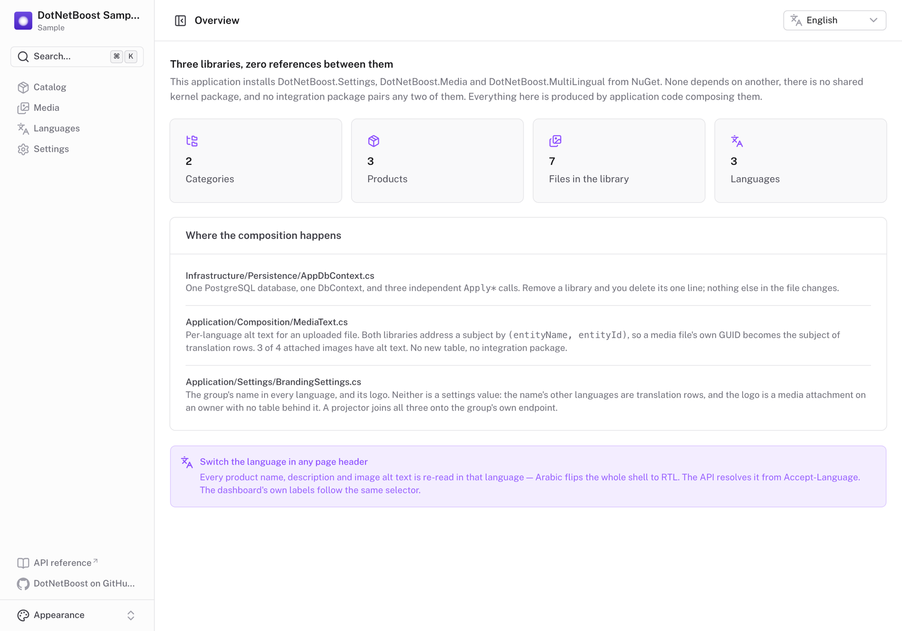
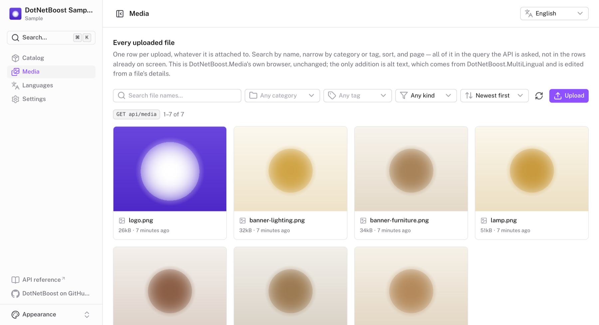

# DotNetBoost Sample

**Four DotNetBoost libraries in one application, with zero references between them.**

This sample installs [DotNetBoost.Settings](https://www.nuget.org/packages/DotNetBoost.Settings.Core),
[DotNetBoost.Media](https://www.nuget.org/packages/DotNetBoost.Media.Core),
[DotNetBoost.MultiLingual](https://www.nuget.org/packages/DotNetBoost.MultiLingual.Core) and
[DotNetBoost.Auditing](https://www.nuget.org/packages/DotNetBoost.Auditing.Core) from nuget.org and
composes them into a small product catalogue: categories and products with translated names,
product images with per-language alt text, branding you can change at runtime, and a trail of who
changed what, when, and from what to what.

What it demonstrates is as much what is *absent* as what is present:

- no `DotNetBoost.Core` or `DotNetBoost.Abstractions` shared-kernel package
- no `AddDotNetBoost(b => b.AddSettings().AddMedia())` unifying builder
- no integration package pairing any two libraries

Each library is installed and configured on its own. Everything that joins them is this
application's code, in nine files, [listed below](#where-the-composition-happens). `tests/` asserts
that no library references another, so the claim cannot quietly stop being true.

**Auditing was added last, to a solution the other three were already in** — the one measure of
"no shared kernel" that cannot be faked by reading libraries already installed. It cost one `Apply*`
line, one registration block and `UseAuditing(sp)` beside `UseMultiLingual(sp)`, and no handler
records anything. It also exposed the real cost of independence: for one release its change capture
could not be used here at all, until `1.0.0-preview.2` added one builder method.
[MultiLingual's row is not in the trail](#6-multilinguals-row-is-not-in-the-trail) is that finding
and its fix.

Around the libraries is a monolith in four projects, with its routes written as vertical slices
dispatched as commands and queries — one file per feature, no MediatR. [How the application is
built](#how-the-application-is-built) covers that; the composition comes first, because it is the
point.

---

## The dashboard



A sidebar shell with **Catalog**, **Media**, **Languages**, **Audit** and **Settings**, and a
reading-language selector in every page header.

**One selector moves both languages.** The content language is a DotNetBoost.MultiLingual row the
API resolves from `Accept-Language`; the dashboard's labels are static bundles under
`clients/dashboard/i18n/locales` (English, Arabic, French). `app/plugins/ui-language.ts` is the one
file that makes them move together. A language added on the Languages page has content before it
has a bundle: its labels fall back to English, and the shell still flips if it reads right-to-left,
because direction comes from the language row, not the bundle.

The choice is remembered across visits, with its direction cached beside it, so a remembered Arabic
opens right-to-left on the first paint. A language deleted in the meantime falls back to the default.

| English | العربية |
|---|---|
|  |  |

Counts use CLDR plural rules, so two products read **منتجان** (the Arabic dual) and zero reads
*0 produit* in French. Dates and file sizes come from `Intl` in the UI locale.

The sidebar header is the sample in miniature: the store **name** is a DotNetBoost.Settings value,
the **logo** is a DotNetBoost.Media attachment, the logo's **size** is another setting, and only
`BrandingProjector` knows all three exist. Change any of them and the header follows on the next
read — no restart.


**Settings** lists the registered `[SettingGroup]`s down the side, from `GET /api/settings`, and one
page — `pages/settings/[route].vue` — draws every group from what the group says about itself:

- **The form** is generated from `GET /api/settings/{group}/schema`: a `bool` becomes a switch, an
  `int` a number field, a `string` an input. Add a property to the C# class and the field appears.
- **The bounds** come from the group's FluentValidation rules, which the schema publishes — so
  `headerLogoSize`'s 16–64 range is `BrandingSettingsValidator`'s, and saving 500 is refused with
  `400` by the same rule the form drew.
- **`translated`** comes from this application's `MultiLingualSchemaContributor`, because the
  settings engine has never heard of `[MultiLingual]`. That flag is what adds the *Store name in
  other languages* card.
- **The logo box** appears because the group's response publishes the media owner it is filed
  under, and `GET /api/media/roles/Branding` says that owner has one role.

Adding a settings class in C# adds a working entry here with no client change. The only
per-group thing in the client is an icon in `app/utils/settings.ts`.

Saves are conditional: the `GET` returns an `ETag`, the `POST` sends it as `If-Match`, and a save
that would overwrite someone else's is refused with `412`. The form then offers to re-apply only the
fields you edited on top of the latest values.

The **Catalog** group is read somewhere other than the page that writes it. `PageSize` is how many
products `GET /api/products` answers with, and `CurrencySymbol` is the glyph `Intl` places beside a
price (`€349.00` in English, `349.00 €` in Arabic). Change `PageSize` from 12 to 2 and the products
list pages by two, with no restart.

**Languages** is DotNetBoost.MultiLingual's page: code, native name, direction, default marker, an
active switch, and edit, make-default, delete-translations and delete per row. Refusals are shown in
the API's words, and leaving Direction as "from the code" lets the API derive it — `he` comes back
right-to-left without being told.



**Media** is DotNetBoost.Media's browser — search, filters, sorting, paging, upload, details,
attachments and delete, all of it parameters on the API query. The one addition is **alt text** in
a file's details: not media data at all, but MultiLingual rows filed under the subject `MediaFile`.

**Catalog** has Categories and Products tabs, and each editor is the composition on one form: a
button per language with that language's fields, and a box per media role read from
`GET /api/media/roles/{entityName}` — a category's `banner`, a product's `primary` and `gallery`.
Attaching, detaching and reordering go straight to the media library's own endpoints; this
application has none of its own. The products list sends no page size, so the API's
`CatalogSettings.PageSize` decides it and the pager reads back what was used. Saves and deletes are
reported in the API's own sentences, in the reading language — see [What a catalogue write answers
with](#what-a-catalogue-write-answers-with).


**Audit** is DotNetBoost.Auditing's trail. Its endpoints require an authenticated caller by default,
and this sample keeps that default; a [stand-in
scheme](src/DotNetBoostSample.Api/Authentication/SampleActorAuthentication.cs) signs every request
that names nobody in as `sample.user@example.com`, so the dashboard needs no sign-in and your writes
are attributed to that user.

The filters — entity, key, actor, action, date range — are parameters on the API query. The entity
list and the page-size bound come from `GET /api/audit/entities`, not from the client. Pages are
numbered, by offset with a total, and go back to page 1 whenever the filter changes. An entry
expands to what moved, old value → new; a **redacted** change is drawn as "not disclosed" rather
than as a blank, and a **null actor** as `unknown`, never "system".

Pick an entity and the page shows **what is recorded for it**, from the model rather than the
entries. `Name` and `Description` are reported as `Ignore` — which is where someone who edited a
product's Arabic text and saw no new entry finds out why. See [A translated property is not in the
trail](#7-a-translated-property-is-not-in-the-trail).

## Run it

Needs **.NET 10 SDK**, **Node 22+**, and a **container runtime** (Docker Desktop, OrbStack or
Podman) for PostgreSQL. The three class libraries also build for `net8.0`, using the .NET 8
reference packs.

```bash
aspire run
```

Or, without the Aspire CLI:

```bash
dotnet run --project aspire/DotNetBoostSample.AppHost
```

The Aspire dashboard shows `postgres`, `api` and `dashboard`; open the `dashboard` URL. The first
run creates and seeds the database: three languages (English, Arabic, French), two categories and
three products, each translated. Switch the language in the header and the content, the labels and
the layout direction all follow.

### Each piece on its own

Useful when working on the dashboard against an API that is already running.

**The API** needs PostgreSQL and the `catalog` connection string the AppHost otherwise injects:

```bash
ConnectionStrings__catalog="Host=localhost;Port=5432;Database=catalog;Username=postgres;Password=postgres" \
  dotnet run --project src/DotNetBoostSample.Api
```

It listens on `http://localhost:5180`, with its Scalar reference at `/scalar`. To read the trail as
someone other than the default sample user, send the stand-in header — which verifies nothing:

```bash
curl -H 'X-Sample-Actor: alice@example.com' \
  'http://localhost:5180/api/audit?entityName=Product&take=10'
```

**The dashboard** needs its dependencies installed and the API's address:

```bash
cd clients/dashboard
npm install
NUXT_API_URL=http://localhost:5180 npm run dev
```

It listens on `http://localhost:3000`. `NUXT_API_URL` is read by the Nitro proxy in
`server/api/[...path].ts`, never by the browser: every call goes to the dashboard's own origin and
is forwarded. `clients/dashboard/.env.example` has the other settings worth overriding. Its checks
are `npm run lint`, `npm run typecheck` and `npm test`.

---

## Where the composition happens

Nine files of this application's own code. Each is a place where it says two libraries are talking
about the same thing — the only way they ever find out, since none references another — or, for the
last three, where one library's data has no place in another's in the shape it is stored in:

| | File | Joins | What it says |
|---|---|---|---|
| 1 | `Infrastructure/Persistence/AppDbContext.cs` | all four | these tables live in one database |
| 2 | `Application/Composition/MediaText.cs` | Media × MultiLingual | a file's alt text is a translation of the subject `("MediaFile", <id>)` |
| 3 | `Application/Composition/MediaTextCleanup.cs` | Media → MultiLingual | when the file goes, that text goes |
| 4 | `Application/Composition/MultiLingualSchemaContributor.cs` | Settings × MultiLingual | this settings property is translated |
| 5 | `Application/Settings/BrandingSettings.cs` | Settings × Media × MultiLingual | branding's name, its other languages and its logo are one thing |
| 6 | `Infrastructure/DependencyInjection.cs` — one line | Auditing → MultiLingual | MultiLingual's translation row is not in the trail: `.IgnoreEntity<Translation>()` |
| 7 | `Domain/Catalog/Category.cs` and `Product.cs` | MultiLingual → Auditing | a translated property is not in the trail: `[AuditIgnore]` beside `[MultiLingual]` |
| 8 | `Infrastructure/Persistence/SettingGroupAuditObserver.cs` | Settings → Auditing | a settings save is one entry for the group, not one per row |

Nine files in eight entries, because the seventh is one sentence said once per entity. It was five
before Auditing arrived. Three of these exist because two libraries **disagree**, which is a worse
kind of glue than "these two tables are about one thing" — and the reason the count is kept honest
rather than tidy.

**Grep cannot find this list.** Some files name several libraries without joining them —
`Program.cs` and `DependencyInjection.cs` register them side by side, `ListProducts.cs` reads a page
size from one and files from another — while `MediaText` names only MultiLingual, because what ties
it to Media is the string `"MediaFile"`, not a type. A join is an identity assertion, usually a
string, an attribute or a type both sides must agree on, which is why `BrandingOwnerTests`,
`KeyFormatAgreementTests` and `AuditRuleTests` exist.

**Six of the nine name only `DotNetBoost.*.Core`**, so they live in the application and domain
layers beside the code that uses them. Only `AppDbContext`, the `IgnoreEntity` line and
`SettingGroupAuditObserver` are infrastructure, and all three are there because four libraries share
**one `DbContext`**. Joining two libraries is not a persistence concern; joining them in one
database is.

### 1. One database, four libraries — `src/DotNetBoostSample.Infrastructure/Persistence/AppDbContext.cs`

The only place all four libraries' tables are named together, and it is four independent calls:

```csharp
public class AppDbContext(DbContextOptions<AppDbContext> options) : DbContext(options)
{
    protected override void OnModelCreating(ModelBuilder modelBuilder)
    {
        // ... the application's own Categories and Products

        modelBuilder.ApplySettings(this);
        modelBuilder.ApplyMedia();
        modelBuilder.ApplyMultiLingual(this);
        modelBuilder.ApplyAuditing();
    }
}
```

Removing a library deletes its line, and adding the fourth was exactly one line here. An audit entry
points **at** a row by `(entityName, entityId)` with no foreign key back, so auditing something new
needs no migration and a deleted product's history outlives the row.

### 2. Per-language alt text — `src/DotNetBoostSample.Application/Composition/MediaText.cs`

`MediaFile` has no alt-text field, and alt text is both required for accessibility and different in
every language. Both libraries address a subject by the same two strings under *DotNetBoost Entity
Addressing v1*: MultiLingual files translations against `(EntityName, EntityId, PropertyName,
LanguageCode)`, Media files attachments against `(OwnerEntityName, OwnerEntityId)`. **That shared
convention is the entire integration surface.** So the glue declares one subject name and uses the
file's own `Guid` as its id:

```csharp
public const string Subject = "MediaFile";

// One query for a whole page of files, in the request's language, with the same default-language
// fallback the library's EF interceptors apply to a translated entity.
public async Task<IReadOnlyDictionary<Guid, MediaTextValues>> GetManyAsync(…) =>
    await multiLingual.ForMany(Subject, ids).GetAsync(ct) …
```

Writing goes through MultiLingual's own `/api/translations/MediaFile/{id}`, so this class only reads
what this API's *own* responses need — a product listing carries its images' alt text. No new table,
and moving media storage to Azure or S3 does not touch it.

### 3. Deleting a file deletes its alt text — `src/.../Application/Composition/MediaTextCleanup.cs`

MultiLingual stores rows about `("MediaFile", <id>)`, Media deletes the file they are about, and
neither knows the other exists. One handler, registered once, says so:

```csharp
// Infrastructure/DependencyInjection.cs, inside the Media block.
.OnFilesDeleted<MediaTextCleanup>()

public sealed class MediaTextCleanup(MediaText mediaText) : IMediaFilesDeletedHandler
{
    public Task OnDeletedAsync(IReadOnlyCollection<Guid> mediaFileIds, CancellationToken ct = default) =>
        mediaText.DeleteManyAsync(mediaFileIds, ct);
}
```

It runs for every delete, including Media's own `DELETE /api/media/{id}`, and is told only the files
that actually went: `DeleteAllAsync` deletes the files an owner alone held and merely detaches shared
ones, so an image still used elsewhere keeps its alt text. The library logs and swallows a handler's
exceptions, which is right here — the bytes are already gone.

### 4. One library's attribute in another's schema — `src/.../Application/Composition/MultiLingualSchemaContributor.cs`

`GET /api/settings/{route}/schema` can say a property is a required `string` of at most 120
characters, because that is DotNetBoost.Settings' business. It cannot say the property is
**translated**: `[MultiLingual]` belongs to another library. `ISettingSchemaContributor` is the port
for exactly that:

```csharp
public bool CanDescribe(Type type) => MultiLingualMetadata.IsMultiLingual(type);

public IReadOnlyDictionary<string, IReadOnlyDictionary<string, object?>> Describe(Type type) =>
    MultiLingualMetadata.For(type).ToDictionary(
        property => property.Name,
        property => (IReadOnlyDictionary<string, object?>)
            new Dictionary<string, object?> { ["translated"] = true },
        StringComparer.Ordinal);
```

It asks the library which properties are translatable rather than reading the attribute itself, so
it cannot drift from what the translation store writes. Contributors **merge**, so `storeName` comes
back with `required` and `maxLength` from its validator *and* `translated` from here.

### 5. Branding: text from one library, its logo from another — `src/.../Application/Settings/BrandingSettings.cs`

The branding group holds text. Its logo is a **media attachment**, on an owner with no table:

```csharp
[SettingGroup("branding")]
[MediaEntity("Branding")]          // pins the stored owner name against a class rename
[MediaRole("logo")]                // declared on the class, not in AddInfrastructure
public class BrandingSettings
{
    public const string MediaOwnerName = "Branding";
    public const string MediaOwnerId   = "branding";
    public const string LogoRole       = "logo";

    public string StoreName   { get; set; } = "DotNetBoost Sample Store";
    public string AccentColor { get; set; } = "#512BD4";
}
```

```csharp
var branding = await settings.For<BrandingSettings>().GetAsync();
var logo     = await media.For("Branding", "branding").GetByRoleAsync("logo");
```

Products show attaching to rows, which a foreign key can do. Branding has no row — it is a group of
setting rows, and there is only ever one — and a foreign key cannot express that. The media library
does not care: an owner is two strings it never resolves. So the dashboard draws branding's logo
with the same role box it draws a product's image with. The id `"branding"` is degenerate, like
`Id = 1` on a single-row config table, but the library needs both halves of an address.

> **Do not assign to what `GetAsync` hands you.** It is the instance `SettingManager` cached, so
> `branding.StoreName = translated` writes one request's language into what every later reader is
> served. `BrandingProjector` returns a new `BrandingResponse` instead, and an integration test pins
> it, because nothing else would notice.

#### Why the logo is not a `Guid` on the settings class

A file referenced only by a setting's value is **invisible to the media library**: it is used by
nothing, and deleting it warns about nothing until the site loses its logo. Keeping the id *and* an
attachment gives two records of one fact, and nothing keeps them in step when the logo is detached
from the Media page. So the attachment is the only record.

**The cost:** the logo is outside the settings group, so it is absent from
`GET /api/settings/branding`'s stored values, from the group's ETag and from its audit trail. If you
need a file inside a group's versioning, keep the id — and maintain the second record yourself.

#### Why the store name is edited on two cards

The Settings page shows branding's text twice: as a field in the generated form, and in a **Store
name** card with a box per language. They are split by **language**, so no language has two writers:

| Where | Holds | Edited by |
|---|---|---|
| `Setting` row, in the branding group | the **default** language's text | the generated group form |
| `Translation` rows, under `("Branding", "branding")` | **every other** language | the Store name card |

`GET /api/settings/branding` returns the stored row **and**, under `resolved`, the request
language's translation beside it. The form posts the stored value back to the default-language row,
so replacing `storeName` with the Arabic text would save Arabic over English. A renderer reads
`resolved.storeName ?? storeName`; an editor reads `storeName`.

It is not translation rows all the way down, like `Category.Name`, because a settings group is not
in the EF model — there is no column for `ApplyMultiLingual` to strip. Keeping the default language
in the `Setting` row keeps it inside the group's ETag, conditional save and audit trail. For the
same reason `BrandingProjector` does not call `LocalizeAsync()`, which outside base-language mode
nulls a property with no translation and would erase the name in every untranslated language.

**The cost:** two cards instead of one, and the form shows the default language's text while the
sidebar shows the reading language's. It is the mirror of the logo's trade: there, one record won
and the audit trail was given up; here, the audit trail won and a second editing surface was
accepted.

### 6. MultiLingual's row is not in the trail

`src/DotNetBoostSample.Infrastructure/DependencyInjection.cs` — one line, `.IgnoreEntity<Translation>()`
— plus HiLo keys on `Category` and `Product`.

`UseAuditing(sp)` attaches DotNetBoost.Auditing's `SaveChangesInterceptor`, which records every
create, update and delete in the same `SaveChanges` as the change, with no application code. On
`1.0.0-preview.1` that was the one claim in four libraries' documentation this sample **could not
reproduce**. The first save that tracked a translation row — every catalogue write — threw:

```
Translation has a composite primary key (EntityName, EntityId, PropertyName, LanguageCode).
An audit entry records a single key. Give the entity a surrogate key, exclude it with
[AuditIgnore], or record against it by hand with audit.For(name, id).
```

`Translation` is DotNetBoost.MultiLingual's entity, and its natural key is deliberate. Of the three
remedies, this application could use only one:

| | |
|---|---|
| Give the entity a surrogate key | MultiLingual's decision, and a considered one |
| Exclude it with `[AuditIgnore]` | an attribute cannot be applied to a type from the outside |
| Record by hand | what this sample did, for one release |

**Two independent libraries in one database, incompatible at the capture level, and no shared
kernel to arbitrate.** What closed it was a fourth remedy, in the library that raised the problem:

```csharp
services.AddAuditing()
    .UseEntityFrameworkCore<AppDbContext>()
    .DeclareEntities(typeof(Category), typeof(Product))
    .IgnoreEntity<Translation>()          // DotNetBoost.MultiLingual's row
    .Build();
```

`IgnoreEntity<T>()` is the class-level `[AuditIgnore]` for a type the application cannot annotate.
Neither library learned the other's name: the fix was an ignore-list on one builder, not a package
pairing the two.

**Keys are assigned before the save.** For a database-generated key, the interceptor writes the
`Created` entry in a second, nested `SaveChanges` — which on this context also runs through
MultiLingual's interceptor mid-save, and a second save of a just-created entity once wrote an empty
product name over the stored one. Rather than depend on the order of two libraries' interceptors,
the catalogue's entities take HiLo keys:

```csharp
category.Property(c => c.Id).UseHiLo("CategoryIds");
product.Property(p => p.Id).UseHiLo("ProductIds");
```

The id is assigned at `AddAsync`, so a creation's entry goes into the caller's own save. The costs:
ids have gaps, and an older database needs the sequences created past its existing ids, which
`DatabaseInitialiser` does and `SchemaUpgradeTests` checks.

**What the trail holds:** everything this `DbContext` saves except `Translation` and `Setting` —
`MediaFile`, `MediaAttachment` and `Language` as well as the catalogue, and the seed's first run with
no actor. Settings saves are recorded by [the observer](#8-a-settings-save-is-one-entry-not-one-per-row--srcinfrastructurepersistencesettinggroupauditobservercs).
`GET /api/audit/entities` lists only what is **declared** — the application's own two — so the
dashboard shows the libraries' entries under *Any*. `AuditTrailTests` asserts each of these.

### 7. A translated property is not in the trail

`src/DotNetBoostSample.Domain/Catalog/Category.cs` and `Product.cs` — two attributes, one sentence.

```csharp
[MultiLingual]
public class Product
{
    [AuditIgnore] public string Name { get; set; } = string.Empty;          // translated
    [AuditIgnore] public string Description { get; set; } = string.Empty;   // translated

    [NotMultiLingual] public string Sku { get; set; } = string.Empty;       // in the trail
    public decimal Price { get; set; }                                      // in the trail
}
```

An audit entry has no language. `Name: "Desk" → "Writing desk"` would be true of one language and
silent about which — and by default there is no `Name` column at all, so the value compared is
whatever the request's language hydrated. Saying it with the **engine's own attribute** means every
way of recording honours it, and `GET /api/audit/entities/Product` reports it as `Ignore`.

`AuditRuleTests` asserts that every `[MultiLingual]` property is an `[AuditIgnore]` one, read through
each library's metadata — because a translated property added without the second attribute would
produce a trail that confidently says the wrong thing.

### 8. A settings save is one entry, not one per row — `src/.../Infrastructure/Persistence/SettingGroupAuditObserver.cs`

DotNetBoost.Settings stores a group one row per property, so the interceptor alone recorded a
branding save as one entry per value, each addressed by a row id nobody knows. The settings library
already knows where an edit begins and ends, and reports it through `ISettingWriteObserver`:

```csharp
// Settings block
.UseWriteObserver<SettingGroupAuditObserver>()

// Auditing block
.IgnoreEntity<Translation>()
.IgnoreEntity<Setting>();
```

The observer records the group's whole diff as one `Setting` entry addressed by the group's name.
The write carries the group's class as its type, so the ignore — checked by type — does not drop it,
and `[AuditIgnore]` and `[AuditRedact]` on a group's properties apply. A `[Sensitive]` property is
marked redacted, so the trail does not read "changed from nothing to nothing".

**The cost:** this is the one entry that does not commit with its change. The observer runs after
the settings save, and DotNetBoost.Settings logs and swallows its failures, so a failed record leaves
the change without an entry. For dashboard-edited configuration, "catalog: page size 17 → 18" in
one line is worth that.

---

## Two places a language can live

Everything above describes the default mode: a `[MultiLingual]` property has **no column**.
`ApplyMultiLingual(this)` strips `Name` and `Description` off `Categories` and `Products`, and every
language, the default included, is a translation row.

DotNetBoost.MultiLingual has a second mode. Give it a base language:

```csharp
services.AddMultiLingual(o => o.BaseLanguage = "en")
        .UseEntityFrameworkCore<AppDbContext>()
        .Build();
```

and a translatable property **keeps** its column, holding English, while every other language stays
a row. A missing translation falls back to the column; an entity may only be created in the base
language; and that language cannot be deleted or deactivated. Here it is one setting:

```bash
MultiLingual__BaseLanguage=en dotnet run --project src/DotNetBoostSample.Api
```

**Against a fresh database**, because it decides whether `Products` has a `Name` column. It is also
not the *default* language: the default is a row you can change from the dashboard, while the base
language is fixed for the life of the database.

### What the application had to do about it

One class, `Catalog/Shared/TranslatedText.cs`, through which the four writes and two detail reads go:

| `TranslatedText` | In the default mode | With a base language |
|---|---|---|
| `SaveAsync` | queues every language with `Set` and saves | assigns the base language's values to the entity, queues the rest, and saves **in** the base language |
| `LoadAsync` | the query, then `GetAllAsync()` | reads the entity in the base language and adds its columns under that language's code |

Each half answers a refusal the library makes on purpose: `Set("en", …)` throws, because the base
language is not a translation, and a create under `Accept-Language: ar` throws, because the base
value must exist first. Saving in the base language settles both, and the request's language is put
back afterwards so the response sentence stays in Arabic. The read half matters as much: without
it, the editor would open with empty English boxes and save that emptiness over the real text.

The seed authors content in `BaseLanguage ?? "en"`, and `Persistence/MultiLingualModelCacheKeyFactory.cs`
puts the option in EF's model cache key so two hosts with different modes can share a process.
Nothing else asks which mode is on.

### What does not change

**No endpoint's response changes** — same routes, status codes, bodies and `translations` maps. **The
dashboard is not touched**: `NUXT_PUBLIC_BASE_LANGUAGE=en` only makes the Languages page draw a
"base" badge. Subjects without columns — branding, a file's alt text — keep every language as a row
in both modes. One difference is pinned by a test: content created with no base-language text reads
as `""` where the default mode answers `null`, because the column is a non-nullable `string`.

### How that is checked rather than claimed

`dotnet test` boots the sample twice, in two hosts against two schemas.

**The whole integration suite runs in both modes**: fifty-six tests against each, the same
assertions, unchanged — and between them they call **every one of the API's 48 published routes**.
`OpenApiShapeTests` asserts that inventory by name, so a route added by this application or a new
library version fails the suite rather than going uncalled.

`BaseLanguageTests` then asks what only this mode can: that the `Name` column holds English (read
with raw SQL), that the editor's round trip keeps it, that writes in Arabic leave it alone, that
refusals keep their status and language, and that cascades and the other libraries behave the same.
Deleting the one line that puts base-language values on the entity fails six tests, two of them
duplicated default-mode classes running in this mode, while every default-mode copy still passes.

Measured as well: across two freshly seeded APIs, one per mode, the OpenAPI document is
byte-identical apart from its port, and so is every `GET` response across nine endpoints in all
three languages.

---

## What this costs

| | |
|---|---|
| **Glue per app** | Every application writes the join itself: here, 49 lines of code across `MediaText.cs`, `MultiLingualSchemaContributor.cs` and `MediaTextCleanup.cs`, plus `.IgnoreEntity<Translation>()` and two HiLo keys. |
| **Cascade is opt-in** | Deleting a `MediaFile` does not know its alt text exists. One `IMediaFilesDeletedHandler` connects them, but knowing the two records are about one thing is still the application's job. |
| **Magic strings** | `"MediaFile"` has no compile-time link to the type. Mitigated with one `const`, asserted against `MediaEntityNames.For(typeof(MediaFile))`. |
| **Agreement by published spec** | Three libraries must address an entity identically. All implement *DotNetBoost Entity Addressing v1* and publish `EntityKey.AddressingVersion`, and `KeyFormatAgreementTests` spells the agreement out. For Auditing a silent mismatch would not break a join — it would write a trail no read can find. |
| **A capability can be missing until one library moves** | On Auditing `preview.1` the capture could not share a `DbContext` with MultiLingual's composite-key row, and no remedy was this application's. [Section 6](#6-multilinguals-row-is-not-in-the-trail) is the finding and the fix. |

The first four are ergonomics: the price of installing one library without the others. The last
was a capability missing in this combination — the strongest argument *against* this arrangement,
and the one thing an integration package would genuinely have fixed. The fix landed in one library's
builder instead, without a package that knows both names. What it cost was a release of waiting,
which is what four independent release cadences mean.

---

## Tests

```bash
dotnet test
```

### What the code is

These read attributes and type metadata: no database, no host, milliseconds.

- **`ZeroCouplingTests`** — no library references another, or a `DotNetBoost.Core` or
  `DotNetBoost.Abstractions`. The assertions did not change when the fourth library arrived.
- **`KeyFormatAgreementTests`** — Media, MultiLingual and Auditing format the same keys to the same
  strings, and `MediaText.Subject` equals the name Media resolves for `MediaFile`, so a rename
  upstream fails here rather than stranding every stored alt text.
- **`BrandingOwnerTests`** — the logo has exactly one record, the owner name in code is the one the
  attribute stores, and the group's `Id` stays out of the settings table and the JSON.
- **`AuditRuleTests`** — the `[MultiLingual]` and `[AuditIgnore]` properties of each entity are the
  same set, the language-independent columns are recorded, and nothing is redacted.
- **`DocumentedCountTests`** — the counts these documents state are the counts there are.

### What the code does

`tests/.../Integration/` boots **this exact `Program.cs`** through `WebApplicationFactory` against a
throwaway PostgreSQL from Testcontainers and drives it over HTTP, overriding only the connection
string and `Media:Root`. That a plain `ToListAsync()` comes back translated, that alt text written
through one library reads back beside another's file, that a refused write takes its audit entry
with it — none of it is provable without the database the libraries share.

**Every class below runs twice**, once per [language mode](#two-places-a-language-can-live): an
abstract class holds the assertions and two sealed subclasses bind it to each fixture.

- **`CatalogCompositionTests`** — entities come back in the request's language with nothing asking;
  missing translations fall back; alt text reads back on a Media file; messages arrive in the
  reading language; deleting a product takes its images' alt text with it.
- **`CatalogRefusalTests`** — a body of the wrong shape, a `categoryId` naming nothing, a taken slug
  or SKU: each a 400, 404 or 409 in the request's language. All three used to be 500s, found by
  running the application.
- **`CatalogSettingsTests`** — `PageSize` changes the listing with no restart; a caller may override
  it up to the cap.
- **`BrandingCompositionTests`** — the group publishes the media owner its logo is filed under, and
  reading branding in Arabic does not change what the group returns.
- **`MediaShapeTests`** — a file attached under two roles is one image in a listing and two boxes in
  the editor; alt text in several languages is one write.
- **`SettingsSchemaTests`** — the schema carries FluentValidation's bounds and `translated`, merged.
- **`OpenApiShapeTests`** — the document describes what each endpoint actually answers, and holds
  the inventory of all forty-eight routes.
- **`RemainingRouteTests`** — the six routes nothing else called.
- **`AuditTrailTests`** — a product's life in the trail and the history that outlives it; a change
  made straight through `AppDbContext` recorded all the same; no `Translation` entry; settings saves
  as one entry; the right actor on each entry; and **a refused write records nothing**.
- **`AuditRetentionTests`** — retention is off by default, and once switched on,
  `AuditRetentionService` deletes old entries and keeps new ones.
- **`SchemaUpgradeTests`** — a database from before the HiLo keys still boots and creates rows.
- **`BaseLanguageTests`** — what only base-language mode can be asked.
  Fifteen tests, beside the fifty-six the suite runs in each mode.

**Without a container runtime these skip rather than fail** — `dotnet test` still runs the 30 fast
tests and reports the other 128 as skipped, with the reason.

### And the dashboard's own

```bash
cd clients/dashboard && npm test
```

Vitest in Nuxt's test environment, over the composables the pages are built from. Each suite exists
because of something `dotnet test` cannot see:

- **`useSettingsGroup.spec.ts`** — `refreshValues()` picks up a logo attached outside the form and
  keeps a half-typed field; `load()` may discard edits. Attaching a logo once left the old file
  showing.
- **`useLanguageList.spec.ts`** — every reader shares one request, and a language created afterwards
  reaches all of them. The list used to be read under four keys and frozen in each.
- **`useAuditTrail.spec.ts`** — the page goes back to 1 whenever the filter changes, a new filter is
  not answered with the page already in flight, and the declared entities are read once.
- **`uiLanguage.spec.ts`** — one reading language moves the labels, `uiText` and `Intl`; `fr-CA`
  reads in French; and Hebrew, with no bundle, gets English labels and an RTL shell.

Each was checked by reverting or breaking what it guards and watching it fail. Specs live under
`test/nuxt/` because that is the path `npm run typecheck` covers.

---

## How the application is built

Four projects, and nothing points back: `Domain` ← `Application` ← `Infrastructure`, with `Api`
composing all three.

| Project | Targets | Holds | Must not reference |
|---|---|---|---|
| `Domain` | `net8.0;net10.0` | `Category`, `Product` | anything but `DotNetBoost.MultiLingual.Core` and `DotNetBoost.Auditing.Core` |
| `Application` | `net8.0;net10.0` | the eleven slices, the dispatcher, the composition, the settings groups | Npgsql, the `*.EntityFrameworkCore` packages, the `*.API` packages |
| `Infrastructure` | `net8.0;net10.0` | `AppDbContext`, the EF model, the seeder, `AddInfrastructure()` | ASP.NET endpoint mapping |
| `Api` | `net10.0` | `Program.cs`, `appsettings`, `Resources/*.json` | — |

The class libraries target both frameworks the DotNetBoost packages ship for. The host cannot:
Aspire 13.6 and the Npgsql EF Core 10 provider need `net10.0`. EF Core is pinned per framework in
`Directory.Packages.props`.

`Domain` carries two libraries' attributes — `[MultiLingual]` and `[AuditIgnore]` — from MIT,
abstraction-only packages: the same bargain as `[Required]` on an entity.

### A feature is a file

Each of the eleven routes is one file holding its whole slice — what is asked, what comes back,
what bounds it, who answers it, and the URL:

```csharp
public static class ListProducts
{
    public sealed record Query(int? CategoryId, string? Search, int? Page, int? PageSize)
        : IQuery<PagedResult<ProductListItem>>;

    public sealed record ProductListItem(int Id, string Name, /* … */ AttachedFile? Primary);

    public sealed class Handler(IAppDbContext db, IMediaManager media,
                               ISettingManager settings, MediaText mediaText)
        : IRequestHandler<Query, PagedResult<ProductListItem>> { /* … */ }

    public sealed class Endpoint : IEndpoint
    {
        public void Map(IEndpointRouteBuilder app) =>
            app.MapGet("/api/products", (int? categoryId, string? search, int? page, int? pageSize,
                                         IDispatcher dispatcher, CancellationToken ct) =>
                   dispatcher.SendAsync(new Query(categoryId, search, page, pageSize), ct))
               .WithTags("Products");
    }
}
```

They run 66–147 lines each, comments included. `MapApplicationEndpoints()` and `AddApplication()`
find them by scanning, so `Program.cs` never names one.

Handlers read `db.Products` through `IAppDbContext` rather than a repository, because a plain
`ToListAsync()` coming back translated is the most interesting thing this sample does, and a
repository would hide it. The cost: `IAppDbContext` hands out `IQueryable` and is not a real seam.

### CQRS without MediatR

`Abstractions/Cqrs/Dispatcher.cs` is 57 lines of code: `IRequest`, `IQuery`, `ICommand`,
`IRequestHandler`, `IPipelineBehavior`, `IDispatcher` and the dispatcher. MediatR changed licence at
v13.0 to RPL-1.5 or commercial, and a repository arguing for four MIT libraries with no shared kernel
should not take that on to dispatch eleven handlers. The shape is MediatR's, so swapping back is a
change of `using`s and one registration.

### What a refusal is

A handler that can fail returns `Result<T>` with a message **key**, and one method turns it into
localized RFC 7807 problem details, so no handler takes a localizer:

```csharp
if (category is null) return Error.NotFound("Catalog.CategoryNotFound", request.Id);
if (await db.Products.AnyAsync(p => p.CategoryId == request.Id, ct))
    return Error.Conflict("Catalog.CategoryHasProducts");
```

A duplicate slug or SKU never reaches a handler: the unique index refuses it, and
`PostgresErrorTranslator` — the only file that names Npgsql types — turns the constraint name into a
`409`. Reading a `PostgresException` cannot happen in `Application` and `IExceptionHandler` cannot
happen in `Infrastructure`, so the translator is an interface implemented on the provider's side.

### Why four projects for 47 files

It is more structure than 1,800 lines of behaviour needs, deliberately: the dependency rules above
are enforced by the build, not by a comment. The cost is that a route no longer shows what it does —
`MapGet` → `IDispatcher` → handler is three hops. [`ARCHITECTURE-SLICES.md`](ARCHITECTURE-SLICES.md)
has the design as written and every place it changed on contact with a compiler.

---

## Layout

```
src/DotNetBoostSample.Domain/            Category and Product
src/DotNetBoostSample.Application/
  Abstractions/Cqrs/                     the dispatcher, ValidationBehavior, and its 400
  Abstractions/Persistence/              IAppDbContext, and the 409 for a refused constraint
  Abstractions/Endpoints/                IEndpoint, and the scan that maps them
  Abstractions/Results/                  Result<T>, Error, and the RFC 7807 response
  Catalog/Categories/, Catalog/Products/ the eleven slices
  Catalog/Shared/TranslatedText.cs       an entity's text in every language, in either mode
  Catalog/Shared/AttachedFiles.cs        an owner's files, with roles and alt text
  Composition/                           MediaText, MediaTextCleanup, MultiLingualSchemaContributor
  Settings/                              Branding, Catalog and Auditing settings groups
src/DotNetBoostSample.Infrastructure/
  Persistence/AppDbContext.cs            one database, four Apply* calls
  Persistence/Configurations/            one per entity: unique indexes and HiLo keys
  Persistence/DatabaseInitialiser.cs     schema and seed on first run, and upgrades for old volumes
  Persistence/SettingGroupAuditObserver.cs
  Persistence/PostgresErrorTranslator.cs
  DependencyInjection.cs                 AddInfrastructure(): four independent blocks
src/DotNetBoostSample.Api/
  Program.cs                             the host
  Authentication/                        the header-trusting stand-in scheme
  Auditing/AuditRetentionService.cs      prunes the trail as the auditing group says
  Resources/{en,ar,fr}.json              the API's own messages
aspire/                                  AppHost (postgres + api + dashboard), ServiceDefaults
clients/dashboard/                       Nuxt 4 + shadcn-vue
  app/pages/                             overview, catalog, media, languages, audit, settings
  app/plugins/ui-language.ts             moves the UI locale with the reading language
  app/composables/                       one per screen's data, plus useShellLocale for direction
  i18n/locales/{en,ar,fr}.json           the dashboard's own labels
  test/nuxt/                             Vitest over the composables
tests/DotNetBoostSample.Tests/           the claims, as tests; Integration/ boots the real host
docs/screenshots/                        the images above, and how to retake them
media/                                   uploaded bytes at runtime (gitignored)
```

---

## Endpoints

Each library maps its own, with no coordination:

| From | Route |
|---|---|
| `DotNetBoost.Settings.API` | `GET /api/settings`, `GET/POST /api/settings/{group}`, `GET /api/settings/{group}/schema` |
| `DotNetBoost.Media.API` | `/api/media`, `/api/media/{id}/content`, `/api/media/{id}/url`, attachments and roles |
| `DotNetBoost.MultiLingual.API` | `/api/languages`, `/api/translations/{entityName}/{entityId}` |
| `DotNetBoost.Auditing.API` | `GET /api/audit`, `GET /api/audit/{id}`, `GET /api/audit/entities[/{entityName}]` — **authorized** |
| This application | `/api/categories`, `/api/products` |

The audit routes are the only authorized ones, and that is the library's default: a trail is a map
of who did what. `MapAuditEndpoints()` is called bare, keeping it. Its erasure and prune endpoints
are **not mapped** — nothing in a sample should destroy history over HTTP.

`GET /api/products` takes `categoryId`, `search`, `page` and `pageSize` and answers
`{ items, total, skip, take }`, the shape Media's own listings use. With no `pageSize` the API uses
`CatalogSettings.PageSize` and reports it in `take`; any size is clamped to `MaxPageSize`. `search`
matches name and description **in the request's language** — the handler filters `p.Name` as if it
were a column and MultiLingual's interceptor rewrites it — so "مكتب" finds the writing desk under
`Accept-Language: ar`.

**A file and a file-in-a-role are different shapes.** Listings (`images`, `primary`, `banner`,
`logo`) carry a file and its text with no role, because one file can be attached under several
roles. Detail endpoints carry `role` and `sortOrder`, because a role box asks about links. So a
product using one image as both `primary` and `gallery` is **one** image in the list and fills
**two** boxes in the editor. No shape carries a URL: the dashboard builds every image URL from the
file id, because Media's `url` is a signed link that is null on the file-system backend.

Roles are declared once, and the editor grows a box for each:

```csharp
.DeclareRoles("Product",  roles => roles.One("primary").Many("gallery"))
.DeclareRoles("Category", roles => roles.One("banner"))
.DeclareRoles<BrandingSettings>()   // reads [MediaRole] off the class
```

Full reference at `/scalar` on the API.

### What a catalogue write answers with

Entity content is translated by MultiLingual's interceptors; the API's **own sentences** — "the
category was saved", a 404, a 409 — are not entity content. They come from `Resources/{en,ar,fr}.json`
through `.AddJsonLocalization()`, which answers in `IMultiLingualManager.CurrentLanguage` rather than
`CurrentUICulture`, so a refusal and the content it is about cannot disagree about the language.

| | Answers | Body |
|---|---|---|
| `POST /api/categories`, `POST /api/products` | `201` | `{ id, message }` |
| `PUT /api/categories/{id}`, `PUT /api/products/{id}` | `200` | `{ message }` |
| `DELETE /api/categories/{id}`, `DELETE /api/products/{id}` | `200` | `{ message }` |
| `POST /api/products/{id}/images` | `200` | `{ id, fileName, size, message }` |

`200` rather than `204`, because a `204` has nowhere to put the sentence. Refusals carry their
sentence in RFC 7807's `detail`, the same shape MultiLingual's own endpoints produce:

| | Answers | Decided by |
|---|---|---|
| A field of the wrong shape — empty slug or SKU, negative price | `400` + `errors` | the slice's `Validator`, run by `ValidationBehavior` |
| An id in the route, or a `categoryId` in the body, naming nothing | `404` | the handler — the only code that knows *which* id was wrong |
| A category that still has products | `409` | the handler |
| A slug or SKU already taken | `409` | the unique index, read back by `PostgresErrorTranslator` |

```console
$ curl -X DELETE /api/categories/3 -H 'Accept-Language: ar'
409  {"detail":"انقل منتجات هذا التصنيف أو احذفها أولًا."}

$ curl -X DELETE /api/products/4 -H 'Accept-Language: fr'
200  {"message":"Le produit CASE-002 a été supprimé."}
```

A success names the row by its **slug or SKU**, which confirms the edit landed where it was meant; a
404 names the id, the only handle the caller has. The dashboard's toast takes its title from its own
bundle and its description from the API's sentence.

---

## Configuration

**`MultiLingual:BaseLanguage`** is empty by default, so every language is a translation row. Set it
(`MultiLingual__BaseLanguage=en`) against a fresh database to keep one language in the entities' own
columns — see [Two places a language can live](#two-places-a-language-can-live).

**Media** bytes go to `./media` on local disk. Azure Blob Storage or S3 is one line in
`Infrastructure/DependencyInjection.cs`, and files uploaded before a switch keep working, because
each row records which backend wrote it:

```csharp
.UseFileSystem(mediaRoot, isDefault: true)     // this sample
// .UseAzureBlobStorage(connectionString, "media", isDefault: true)
// .UseAmazonS3(…)
```

**`X-Sample-Actor`** is the sample's stand-in for authentication: whoever it names is the actor on
the audit entries a request produces, and a request without it is signed in as
`sample.user@example.com`. It verifies nothing. Replacing
`Authentication/SampleActorAuthentication.cs` with a real scheme is the whole change, since the
engine only asks `HttpContext.User`.

**Retention is a settings group, off until you turn it on.** The **Audit trail** group holds whether
old entries are deleted, after how many days (365 by default), and how often to check (every 24
hours by default). `AuditRetentionService` reads it every minute, so an edit applies without a
restart. Retention is the only Auditing option exposed this way because it is the only one that can
follow an edit; the rest are read once, at `Build()`.

## License

MIT.
